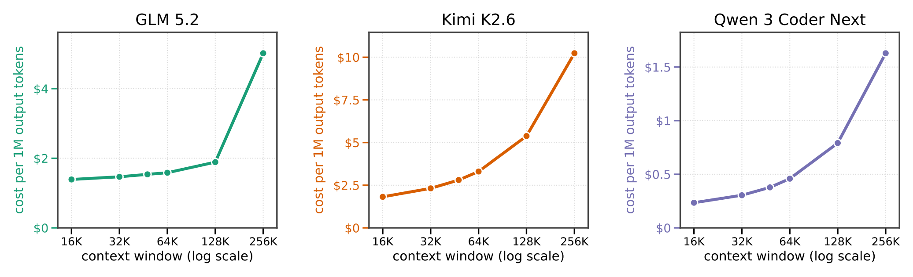
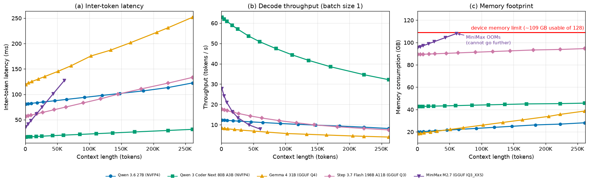
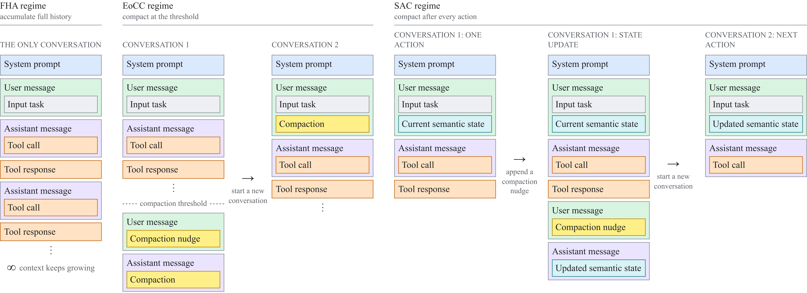
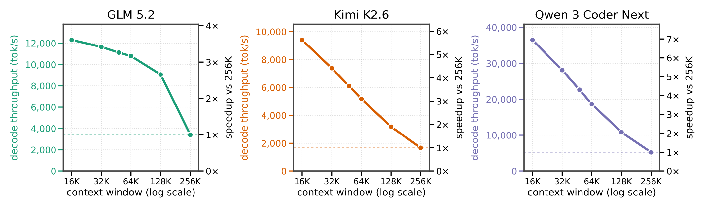
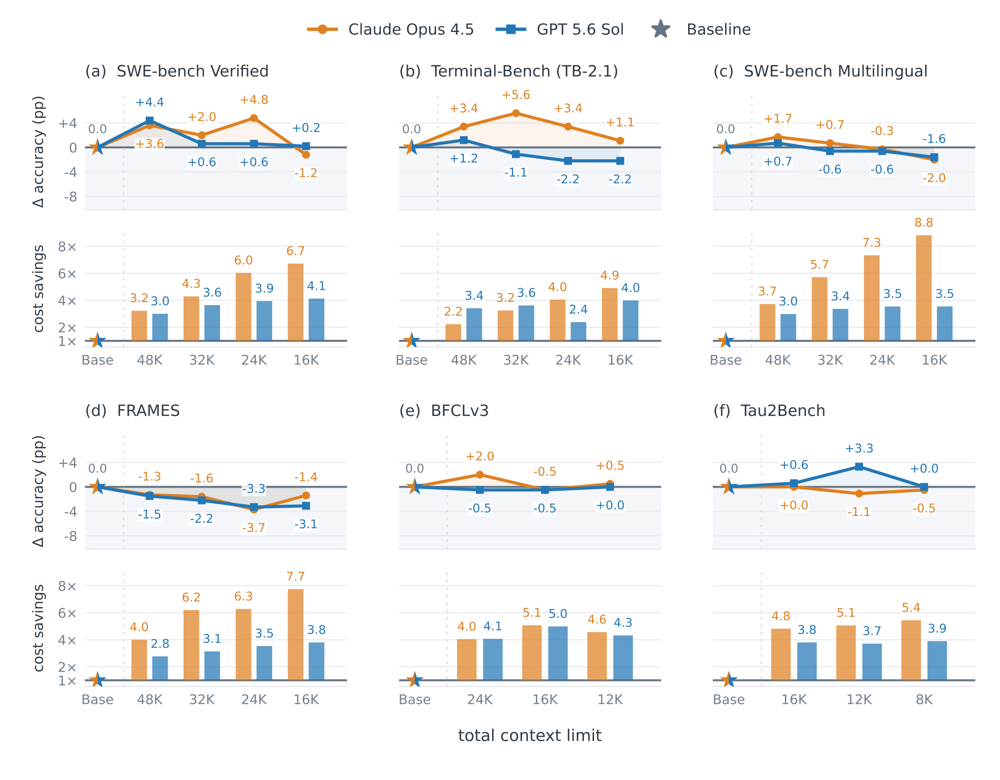
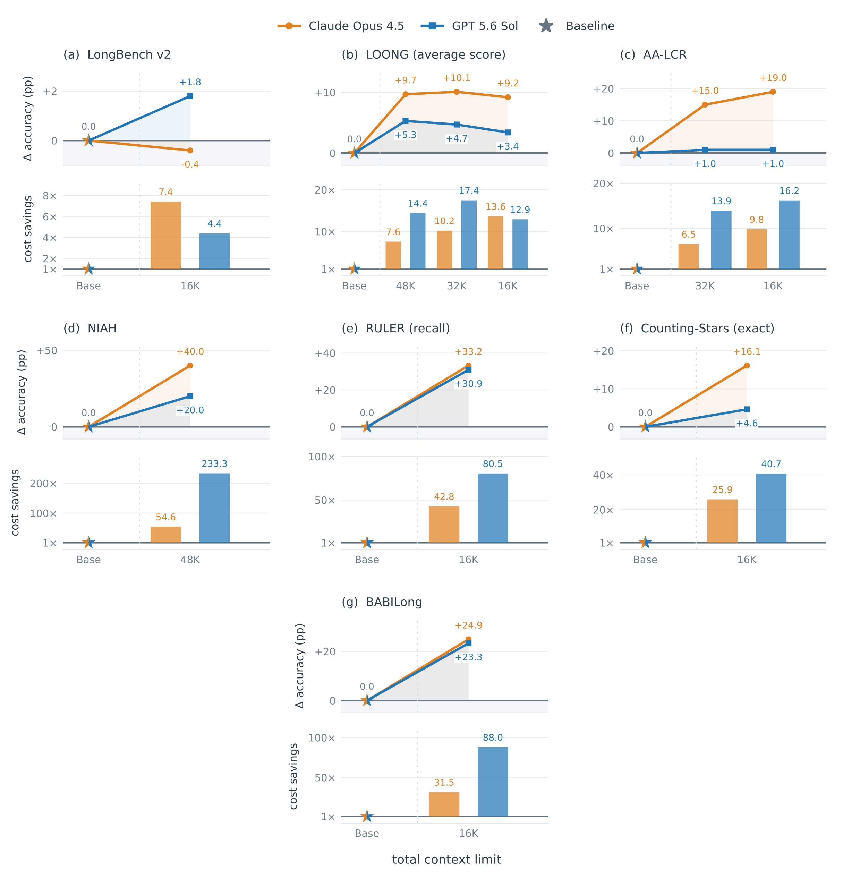
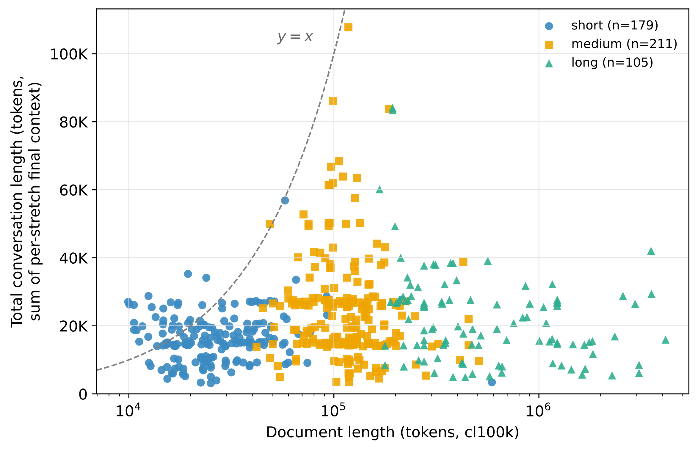
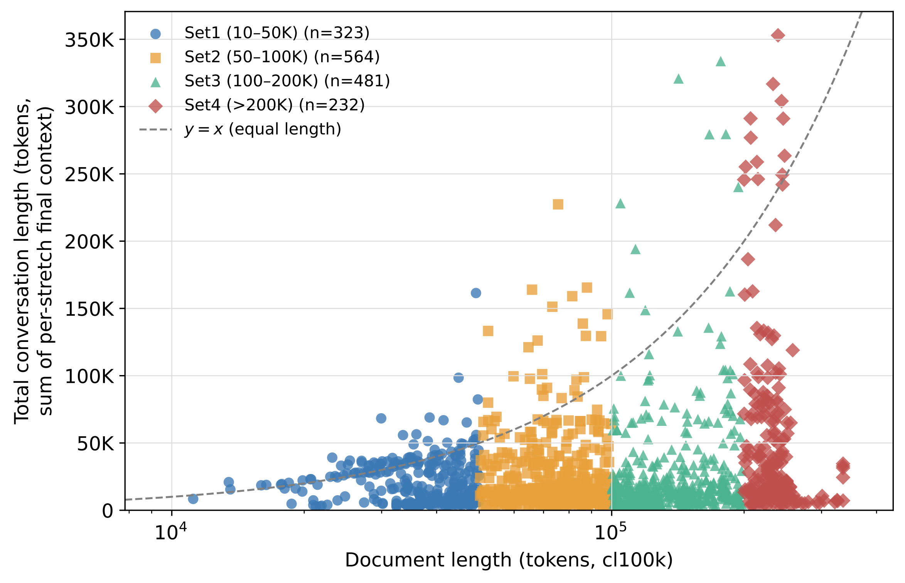

---
AIGC:
    Label: "1"
    ContentProducer: 001191440300708461136T1XGW3
    ProduceID: 1bb012f8b4a19978123c2360a25e5a6f_05af8337e16311f19919525400638852
    ReservedCode1: qzesob9Qv9cOI0zN2WZ/TUGrGqJGi6waO5qeh8h1/kQ5k+14Fzg8P9x9ElJmyBFWITF4g6gxeCgdZsRZmZ7nmE6QWbHpKr9h23Apm244p3QcyBoSZbuG6Savd+EkRPyS2M5N50r48VMctr++mgOXS3zmmPvX48cdX5sRs2MYuYWMVyut4154FYZDrL8=
    ContentPropagator: 001191440300708461136T1XGW3
    PropagateID: 1bb012f8b4a19978123c2360a25e5a6f_05af8337e16311f19919525400638852
    ReservedCode2: qzesob9Qv9cOI0zN2WZ/TUGrGqJGi6waO5qeh8h1/kQ5k+14Fzg8P9x9ElJmyBFWITF4g6gxeCgdZsRZmZ7nmE6QWbHpKr9h23Apm244p3QcyBoSZbuG6Savd+EkRPyS2M5N50r48VMctr++mgOXS3zmmPvX48cdX5sRs2MYuYWMVyut4154FYZDrL8=
---

# 你不需要长上下文

> **NVIDIA Research ｜ Project Moonshot ｜ 2026-11-04**
>
> **作者**：Peter Belcak, Saurav Muralidharan, Jindong Jiang, Yonggan Fu, Wonmin Byeon, Hanrong Ye, Ryan Angilly, Ali Taghibakhshi, Shih-Yang Liu, Siru Ouyang, Greg Heinrich, Pavlo Molchanov
>
> **arXiv**：[2611.05306](https://arxiv.org/abs/2611.05306) ｜ [PDF 原文](https://arxiv.org/pdf/2611.05306.pdf) ｜ [HTML 原文](https://arxiv.org/abs/2611.05306v1)
>
> **项目页**：[NVIDIA Lab](https://nv-dler.github.io) ｜ [Project Moonshot: Local Frontier Intelligence](https://research.nvidia.com/labs/lpr/lfi/)
>
> **版本**：arXiv v1，提交于 2026-11-03 18:17:23 UTC
>
> **一句话结论**：后生成的 token 比先生成的更贵——在开源权重前沿模型上差距可达 7 倍。作者用频繁"压缩（compaction）"证明：只要保持短上下文，前沿模型在长程任务与长输入任务上几乎不损失准确率，甚至不降反升；由此提出"语义状态空间模型（SSSM）"的设想，并质疑长上下文模型的必要性。

---

## 关键结论速览（数字均取自原文）

| 维度 | 原文关键数据 |
|---|---|
| 长上下文到底多贵 | 窗口从 16K 拉到 256K，每生成 token 成本高 **3.6×**（GLM 5.2）、**5.6×**（Kimi K2.6）、**7×**（Qwen 3 Coder Next）——来自图 1 |
| 短上下文会掉分吗（长程任务） | SWE-bench Verified 上不降反升：Claude Opus 4.5 **70.0 → 74.8**（+4.8 分），GPT 5.6 Sol **84.4 → 88.8**（+4.4 分）——表 3 |
| 短上下文会掉分吗（长输入任务） | FRAMES 上小幅下降 **1.4 / 3.1** 分，但预估优化成本下降 **7.7× / 3.8×**——表 6 |
| 能压到多狠 | 即使每个上下文只允许 1 个动作（RQ3），长程 SWE 任务性能仍不崩溃——这正是 SSSM 设想的由来 |
| 一句提醒 | 结论覆盖 13 个基准、Claude Opus 4.5 与 GPT 5.6 Sol 两个前沿模型；压缩策略本身有讲究（附录 A 给出"好压缩"的结构） |

---

## 全文目录

- [摘要](#abstract)
- [1 引言](#1-introduction)
- [2 方法](#2-methodology)
    - [2.1 定义](#21-definitions)
    - [2.2 基准](#22-benchmarks)
    - [2.3 模型](#23-models)
    - [2.4 运行框架](#24-harnesses)
        - [2.4.1 对长对话上下文的适配](#241-accommodations-for-long-conversational-context)
        - [2.4.2 对长输入的适配](#242-accommodations-for-long-inputs)
    - [2.5 延迟与吞吐的测量](#25-latency-and-throughput-measurement)
- [3 长程任务不需要长上下文](#3-long-horizon-tasks-dont-need-long-contexts)
    - [3.1 长程任务有时可能需要历史记录](#31-long-horizon-tasks-may-sometimes-need-the-history)
- [4 长输入任务不需要长上下文](#4-long-input-tasks-dont-need-long-contexts)
- [5 压缩可以在每个动作之后进行](#5-compaction-can-be-performed-after-every-action)
    - [5.1 语义状态空间模型（SSSM）](#51-semantic-state-space-models-sssms)
- [6 结论](#6-conclusion)
- [参考文献](#references)
- [附录 A 什么构成好的压缩？](#appendix-a-what-characterizes-a-good-compaction)
- [附录 B 优化后的零售成本估算](#appendix-b-estimated-optimized-retail-cost)
- [附录 C 长程任务的详细结果](#appendix-c-detailed-long-horizon-results)
- [附录 D 开源权重模型的结果](#appendix-d-open-weight-model-results)
- [附录 E 长输入的选择性读取](#appendix-e-selective-reading-of-long-inputs)
    - [E.1 提供给智能体的指令](#e1-instructions-supplied-to-the-agent)
    - [E.2 运行记录中的示例](#e2-examples-from-recorded-runs)
- [附录 F 长输入任务的详细结果](#appendix-f-detailed-long-input-results)
- [附录 G 智能体大纲](#appendix-g-agent-outlines)
    - [G.1 mini-swe-agent](#g1-mini-swe-agent)
    - [G.2 mini-agent](#g2-mini-agent)
- [脚注](#footnotes)

---

**文档说明**：本文件为 NVIDIA Research 论文《You don't need long context》（arXiv:2611.05306）的中文全译。译文以官方 LaTeXML HTML 版本为底本，保留全部 8 张图、17 张表、9 段代码清单、4 个块级公式与 1 条脚注；参考文献条目保留英文原貌，公式以 LaTeX 形式内联，图表中的英文专名、模型名、基准名、代码与提示词均不作意译。图片位于同级 `figures/` 目录。

---

<a id="abstract"></a>
## 摘要

**摘要。** 后来生成的 token 比先前的 token 更贵。在前沿开源权重模型上，这种成本差异可高达 7 倍。通过频繁压缩，我们在广泛的长程任务与长输入任务上表明：前沿语言模型在维持短上下文时，几乎不损失任务准确率，甚至毫无损失。我们进一步证明，即便每个上下文最多只允许采取一个动作，大语言模型在长程软件工程任务上的表现也不会崩溃；基于此，我们勾勒出"语义状态空间模型（semantic state space models, SSSM）"的概念。我们的发现对长上下文语言模型的必要性提出了质疑。

**链接：** [Lab](https://nv-dler.github.io) | [Project Moonshot: Local Frontier Intelligence](https://research.nvidia.com/labs/lpr/lfi/)

---

<a id="1-introduction"></a>
## 1 引言



**图 1：长上下文的代价。** 在已有输入 KV 缓存之上生成 $1$M 输出 token 的美元成本，作为上下文窗口大小的函数；数据由各部署实测的峰值解码吞吐换算而来，按 H100 的按需价格计价（每 GPU-小时 $\$3.85$，Nebius，2026 年 9 月）。输入请求长度均匀随机抽取。GLM 5.2 与 Kimi K2.6 以 INT4 权重、BF16 激活服务，Qwen 3 Coder Next 以 BF16 服务。以 $256$K 而非 $16$K 的上下文窗口提供服务时，GLM 每个生成 token 的成本高出 $3.6\times$，Kimi 高出 $5.6\times$，Qwen 高出 $7\times$。

并非所有 token 的生成都是等价。token 生成延迟与内存占用，都会随语言模型上下文中 token 数量的增长而增长。其根源在于：生成一个 token 的计算成本与该 token 在上下文中所处的深度之间存在固有的线性[^1]关系 [25]。图 1 给出了若干热门开源权重模型在云端生成 token 的成本随上下文窗口大小变化的曲线。可以看到，让模型在云端 GPU 上始终以更短的上下文提供服务，能带来可观的经济收益。这一事实往往对终端用户是隐形的，因为零售端 token 定价是按每 $1$M token 固定报价，与输入上下文长度无关。需要注意的是，这里的成本降幅（$3.6\times$ 至 $7\times$）足以比肩甚至超过许多其他正交的优化手段，例如激进量化或结构化稀疏化 [5, 14, 8]。

当输入变长时，蒙受损失的并不只有 LM 工作负载的金钱成本。

图 2 展示了若干流行的本地运行编码模型的 token 生成延迟、吞吐与内存占用随输入上下文长度变化的曲线。可以看到，在实测的各上下文长度上，多个模型的token 间延迟（inter-token latency）大约翻倍，这意味着在更长上下文下生成一条响应所需的时间也翻倍。

简而言之，提供给语言模型（LM）的输入上下文越长，其输出 token 的生成就越慢、越吃内存、越昂贵。



**图 2：长上下文的重负。** 若干开源模型在单台 NVIDIA DGX Spark 上实测的 token 生成延迟、token 吞吐与内存占用，作为输入上下文长度的函数。对多个模型而言，后段 token 的生成耗时约为前段 token 的 2 倍，且需要更大的内存占用。

既然在云端与边缘侧的 LM 使用中，保持输入上下文简短都有可观收益，人们或许会想当然地认为：流行的 LM 早已自然演化成"只在任务所需的最短上下文上运行"。这与事实相去甚远。表 1 将若干知名文学作品的长度与代表性闭源、开源权重模型的上下文窗口大小作了对比：上下文窗口的规模早已远远超过许多具影响力的著作。看起来，模型的演进方向是容纳越来越大的可能输入，而不是最大化效率。

**表 1：文学作品长度与模型上下文窗口大小的对比。** 词数采用所引英文版本。词到 token 的换算按每个英文词约 $1.33$ 个 token 估算，实际数量随文本与分词器而异。各模型及其上下文窗口大小详见 2.3 节。

**文学作品 | 模型的上下文窗口大小**

| **作品** | **词数** | **token 数** | **模型** | **词数** | **token 数** |
|---|---|---|---|---|---|
| 《老人与海》[21] | $\sim 27$K | $\sim 37$K | MiniMax M2.7 [31] | $\sim 150$K | $200$K |
| 《了不起的盖茨比》[15] | $\sim 48$K | $\sim 64$K | Claude Opus 4.5 [2] | $\sim 150$K | $200$K |
| 《古兰经》（Saheeh 国际译本）[38] | $\sim 156$K | $\sim 207$K | Gemma 4 31B [16] | $\sim 192$K | $256$K |
| 钦定版《新约》[26] | $\sim 181$K | $\sim 241$K | Kimi K2.6 [32] | $\sim 192$K | $256$K |
| 《远大前程》[12] | $\sim 184$K | $\sim 245$K | Qwen 3 Coder Next [9] | $\sim 197$K | $262$K |
| 《魔戒》[42] | $\sim 481$K | $\sim 640$K | Gemini 3.8 Flash [13] | $\sim 750$K | $1$M |
| 《战争与和平》[43] | $\sim 566$K | $\sim 753$K | GLM 5.2 [51] | $\sim 750$K | $1$M |
| 钦定版《旧约》[26] | $\sim 603$K | $\sim 802$K | GPT 5.6 Sol [35] | $\sim 790$K | $1.05$M |

当代 LM 庞大的上下文窗口，与"保持上下文简短"所能带来的实实在在的成本优势，二者因此显得彼此矛盾。尽管理论上在某些情况下更长的上下文或可被认为对模型的任务准确率*有益*，但我们仍须追问：

- **RQ0** 长上下文是*必要的*吗？

若不是，那就干脆弃用长上下文与长上下文模型。而且，假使目前长上下文模型确实还带来某些客观好处，我们很可能可以通过对未来的模型做适当的后训练调整来保住这些好处。

要回答 RQ0，先看语言建模中所谓的长上下文（以及相应的大上下文窗口）从何而来。概括地说，有两类工作负载经常导致长输入上下文被送入 LM：

- **LCW1** 长程任务（long-horizon tasks）负载——任务可能需要许多个动作才能完成，而上下文随着模型向任务完成推进而不断累积 [11, 47, 52]。

- **LCW2** 长输入任务（long-input tasks）负载——任务需要在大量输入信息之上操作 [6, 45, 29]。

更仔细地审视这两类负载就会发现：要完成它们，是否真的必须工作在长上下文之上，并非显而易见。尤其是，为成功完成一次长程操作，并不需要在每一步都回顾 LCW1 的完整对话历史；同样，为让工作负载成功收尾，LCW2 的长输入也不需要始终被整体摄入。此外还可注意到，LCW2 中的任务总可以通过"把长输入保存为资源 + 为 LM 配备一个用于选择性读取输入的工具"折算为 LCW1。

一边是保持 LM 生成上下文简短的种种好处，另一边是"一次性摄入长输入、维持长对话历史"这一流行做法显然缺乏清晰依据——受此二者驱动，我们把 RQ0 拆解为以下研究问题：

- **RQ1** 长程任务能在没有长上下文的情况下完成吗？

- **RQ2** 长输入任务能在没有长上下文的情况下完成吗？

- **RQ3** 长程任务能在每个上下文不超过一个动作的前提下完成吗？

本文余下部分旨在简明地回答这些问题。

---

<a id="2-methodology"></a>
## 2 方法

我们采用同一套方法来回答第 1 节提出的全部研究问题。

<a id="21-definitions"></a>
### 2.1 定义

遗憾的是，"上下文（context）"这一基础术语在语言建模领域已被严重地一词多义地使用。下面我们给出自己的工作定义，用以固定那些在社区中常被模糊理解、又在本文中反复依赖的术语的含义。这些定义中的数值边界只是粗略的经验法则。

**推理步（Inference step）。**

*推理步*是对 LM 的一次调用，用以产生输出。在智能体式（agentic）工作流中，它通常对应对话中的一个智能体回合。

**输入上下文（Input context）。**

在给定推理步上，*输入上下文*是为产生输出而提供给 LM 的完整 token 序列。它可能包含系统指令、任务输入、先前的模型输出、工具返回结果，以及任何其他对话历史。

**输出上下文（Output context）。**

在给定推理步上，*输出上下文*是该推理步中由 LM 生成的完整 token 序列。它可能包含思维轨迹、工具调用、面向用户的输出，或其他模型产出物。

**上下文（Context）。**

在给定推理步上，*上下文*指输入上下文，或输入上下文与其关联的输出上下文，或输入上下文与为可能的输出上下文预留的任何 token 空间。

**上下文窗口与上下文窗口大小（Context window and context window size）。**

*上下文窗口*是 LM 在任一时点所能理解的 token 空间，通常由模型架构所限定，或间接由其训练后数据的偏置所限定。超出上下文窗口的上下文可能导致系统错误或异常行为。*上下文窗口大小*是一个 LM 端点在一次调用中能处理的最大 token 数，无论该限制来自模型的上下文窗口，还是被其服务配置收窄。

**长上下文（Long context）。**

当我们称一个上下文为*长*时，是指其长度已接近构成当代许多前沿模型上下文窗口大小的相当比例——在本研究进行时，该比例大约落在 $256$K token 或更多。我们进一步把某种执行机制或上下文管理策略称为*长上下文式（long-context）*，如果它允许上下文朝该量级增长，即便单次运行在达到上下文窗口大小之前就已终止。

**短上下文（Short context）。**

当我们称一个上下文为*短*时，是指其长度相对于当代许多前沿模型常见的上下文窗口大小而言更接近零。在本文所强调的运行机制中，短上下文通常被限制在约 $16$K–$50$K token 区间。请注意，我们把"短"理解为相对于常见上下文窗口大小而言的短；它并不意味着该上下文在绝对语言意义上规模很小。即便是 $16$K–$50$K token 的上下文窗口大小，也足以容纳篇幅繁复的文学作品（参见表 1）。

**长输入任务（Long-input task）。**

*长输入任务*是伴随*长输入*的任务——所谓长输入，即若被直接摄入便会构成一个长上下文的输入信息。*长输入*一词指的是可用任务输入的规模，与运行框架是把它一次性全部放入模型上下文、还是通过选择性读取输入来暴露它无关。

**长程任务（Long-horizon task）。**

*长程任务*是完成需要许多顺序模型动作的任务，其中后发生的动作依赖于先前动作所产生的观察、产物或决策。若不进行上下文管理，由此产生的交互历史会随任务推进不断累积，并可能增长至模型的上下文窗口大小、形成长上下文。

<a id="22-benchmarks"></a>
### 2.2 基准

我们通过两组基准来评估 RQ1、RQ2 与 RQ3 的价值，这两组基准对应第 1 节所识别的长上下文来源：长程任务（LCW1），其交互历史随智能体行动而增长；以及长输入任务（LCW2），其源材料本身就可能填满甚至超出模型的上下文窗口大小。我们所构建的基准ensemble覆盖了贴近真实的软件工程、信息查找与工具使用工作负载，并附加了受控的长输入诊断项。

**长程任务基准组。**

长程任务基准组旨在表征真实的顺序工作流：模型必须反复检查环境、选择动作、观察结果，并利用该结果决定下一步做什么。若不进行上下文管理，每一条命令、工具响应、检索到的文档与中间决策都会被追加到不断增长的历史中。软件工程类基准是尤其具代表性的例子，因为仓库探索、实现与验证天然构成相互依赖的长动作序列。其余基准则把这一组扩展到信息检索、用户交互与跨工具编排。

- **SWE-bench Verified** [23] 是经人工验证的 500 个真实 GitHub issue 解决任务集合，来自流行仓库，智能体必须产出一个能通过仓库留出测试套件的补丁。

- **SWE-bench Multilingual** [48] 包含 300 个手工筛选的 issue 解决任务，来自横跨九种编程语言的仓库。它检验跨不同语言生态的仓库探索、实现与验证。

- **Terminal-Bench 2.1** [30] 是包含 89 个真实命令行任务的智能体式基准，任务在沙箱容器中执行、由每任务专属的校验器打分，衡量超出单仓库打补丁范围的端到端终端问题求解能力。

- **FRAMES** [27] 包含 824 个高难度多跳问题，其答案需要综合二至十五篇维基百科条目的信息。在我们的智能体式形式化设定中，模型检索一个固定的维基百科语料库、逐步打开相关条目，并提交自由形式的答案，由 LM 评判器对照参考答案评估。因此该基准检验迭代式检索与证据整合，同时允许检索到的证据在交互历史中累积。

- $\tau^{2}$**-bench** [7] 评估智能体在显式策略约束下操作领域专用工具、并与模拟用户对话的能力。我们使用跨零售、航空与电信的 184 任务金标准集；成功既要求满足用户请求，也要求把环境带到正确的最终状态。它混合了对话、推理与改变状态的工具调用，用以检验交互早期确立的信息能否被后续动作所用。

- **BFCLv3** [36] 评估模拟环境中的多轮工具使用。我们使用其 200 个长上下文片段（episode），这些片段要求智能体跨用户轮次保留信息并调度改变状态的工具调用。

**长输入任务基准组。**

长输入任务基准组让任务问题保持相对简短，同时让回答问题所需的信息（至少原则上）变得庞大。它包含三个覆盖面广、贴近真实的长文档问答基准，以及四个"针"式（needle-style）基准。

- **LongBench v2** [6] 包含 503 个高难度多选题，输入异质且以自然文本为主，长度从 $8$K 词到约 $2$M 词不等。其六个任务族覆盖单文档与多文档问答、长上下文学习、长对话、代码仓库理解与结构化数据理解。

- **LOONG** [45] 是包含 1,600 个问题的多文档基准，一个问题通常依赖于多份完整的财报、法律案件或学术论文（英文或中文）。其定位、比较、聚类与链式推理任务经过专门设计，使证据分散在多份起承重作用的文档之中。

- **Artificial Analysis 长上下文推理（AA-LCR）** [4] 包含 100 个人工编写的问题，需要在平均约 $100$K 输入 token 的真实文档集合上进行推理。其七类文档包括公司与行业报告、政府征求意见稿、学术与法律文件、营销材料以及调研报告。回答需要跨文档整合证据并执行多步推理，而非检索某个直接陈述的事实。

- **大海捞针（Needle in a Haystack, NIAH）** [24] 的做法是把目标句子插入无关散文长文中的受控深度处，然后要求说出该句子所表达的事实。我们的 125 个实例网格同时变化插入深度与文档长度，上下文从 $16$K 延伸到约 $500$K token。

- **RULER** [22] 是合成式长上下文套件，包含十三个任务：八种针检索变体、变量追踪、常见词与高频词抽取，以及两个多跳问答任务。我们在 $256$K 与 $500$K token 上评估全部十三个任务，并对所需答案集合的召回率打分。

- **Counting-Stars** [39] 把 32 个标记数字散布在一篇长文中，要求模型把它们全部找回。我们使用完整的 192 题公开集，覆盖英文与中文、获取型与推理型变体，文档长度从 $4$K 到 $128$K token。推理型变体中包含初始错误、随后被纠正的计数，要求模型把最终值与邻近的干扰项区分开，而不是简单照抄每一个被标记的数字。

- **BABILong** [28] 由来自 bAbI [46] 推理任务的短事实嵌入书籍正文构成。回答需要先定位相关陈述，再执行事实串联、计数、否定或集合追踪等操作。我们评估 550 个问题，覆盖全部十种任务类型与从 $64$K 到 $1$M token 的五种输入长度。

请注意：即便是这里考察的"针"式基准，也往往并不设置明显的词汇重叠来帮助轻松检索。不过，它们确实要求对多个被检索到的事实做聚合、变量追踪或推理，才能产出正确答案。

---

<a id="23-models"></a>
### 2.3 模型

我们的研究在两组模型上进行。大型闭源模型被用作主要任务准确率实验中的执行者，而大型开源权重模型则支撑云端系统吞吐研究以及补充性的本地实验。

**大型闭源模型。**

我们的主要基准实验使用 **Claude Opus 4.5** 与 **GPT 5.6 Sol**。我们选择这两个模型，因为它们能代表用于编码、工具使用及其他长程工作流的强通用模型。使用由不同团队独立开发的模型族，也可降低"观测到的压缩效应只是某一家供应商或某一套后训练配方的特有现象"的风险。

**大型开源权重模型。**

我们在实验的另外两个部分使用大型开源权重模型。第一，图 1 中的云端吞吐研究使用的模型大到需要多 GPU 部署，从而能在服务负载饱和的情况下暴露上下文窗口大小的影响：

- **GLM 5.2** [17, 50]，在最高 $1$M token 的上下文窗口大小上评估；

- **Kimi K2.6** [32]，在最高 $256$K token 的上下文窗口大小上评估；

- **Qwen 3 Coder Next** [9]，在最高 $256$K token 的上下文窗口大小上评估。

我们由这些吞吐测量拟合出上下文成本比，并在附录 B 中定义 RQ1 的"优化后零售成本"估算。

第二，我们使用可本地部署的开源权重模型完成图 2 中的端侧系统测量以及补充性的任务级实验。部署平台为单台 NVIDIA DGX Spark [33]，其 128GB 统一内存中约 109GB 可用于本地 LM 服务。

当源代码或其他任务数据出于隐私或成本原因必须留在端侧时，这类部署就具有现实意义。两个 Qwen 检查点以 NVFP4 [1] 服务；其余三个通过 `llama.cpp` 以 GGUF 权重、3 至 4 比特的 *k*/*i* 量化服务。它们合起来覆盖了混合线性/softmax 注意力、不同的交错式滑动窗口/全局注意力堆栈、门控分组查询注意力，以及常规的全分组查询 softmax 注意力。这种架构多样性有助于在不同注意力机制与后训练特性的模型上检验 RQ1 所主张的"短上下文足够"。

- **Qwen 3.6 27B** [37] 是 27B 参数的稠密模型，以 NVFP4 服务。其各层以 3:1 的模式在 Gated DeltaNet 与门控全注意力之间交替。上下文窗口大小为 $256$K token。

- **Qwen 3 Coder Next** [9] 是稀疏 MoE 模型，总参数 80B、激活参数 3B，以 NVFP4 服务。它采用同样的 Gated DeltaNet/全注意力混合模式，上下文窗口大小为 $256$K token。

- **Gemma 4 31B** [16] 是 31B 参数的稠密模型，以 GGUF 的 `Q4_K_M` 权重服务。它把 $1024$ token 的局部滑动窗口注意力与全局注意力层交错，上下文窗口大小为 $256$K token。

- **Step 3.7 Flash（198B A11B）** [40] 是稀疏 MoE 模型，总参数 198B、激活参数 11B，以 GGUF 的 `Q3_K_M` 权重服务。它以 3:1 的模式交错 $512$ token 的滑动窗口层与全注意力层，采用逐头门控分组查询注意力，上下文窗口大小为 $256$K token。

- **MiniMax M2.7** [10] 是稀疏 MoE 模型，总参数 230B、激活参数 10B，以 GGUF 的 `IQ3_XXS` 权重服务。它全程采用全 softmax 分组查询注意力，上下文窗口大小为 $200$K token [31]。

<a id="24-harnesses"></a>
### 2.4 运行框架

我们使用两个密切相关的基础运行框架。二者都实现一个最小化的 ReAct 循环：任务在初始用户消息中给出，模型一次发出一个 Bash 动作，每个动作及其结果都被追加到对话中 [49]。Bash 环境在启用时向智能体暴露可用的文件、程序与基准专属工具。每次 Bash 调用都将其相关的标准输出、返回码以及任何执行错误视为动作结果。

**`mini-swe-agent`。**

对于软件工程与终端任务，我们使用已发布的 `mini-swe-agent` 运行框架 [41]，仅做各基准所要求的环境集成改动。其系统提示描述软件工程工作流，其 Bash 环境提供任务仓库或容器。完成后，智能体把拟提交的拉取请求作为补丁提交以供评估。

**`mini-agent`。**

对于其余基准，我们使用自研的 `mini-agent` 运行框架——它是 `mini-swe-agent` 向软件工程之外领域的直接泛化。它保留相同的智能体循环、模型接口与 Bash 接口，但使用基准专属的指令、环境与提交规则。指令明确规定可用命令、任务流程与所需答案格式。初始用户消息中只提供系统指令与任务描述；辅助输入与工具通过环境提供。完成后，评估基准的适配器会识别指定的提交命令、抽取其载荷、终止该片段（episode），并以基准评估器要求的格式记录预测结果。

<a id="241-accommodations-for-long-conversational-context"></a>
#### 2.4.1 对长对话上下文的适配

我们比较施加在上述基础运行框架上的三种上下文管理机制。这些机制决定呈现给模型的是哪部分交互历史。三者的运作方式见图 3。



**图 3：上下文管理机制。** 本工作考察的三种上下文管理机制：全历史累积（Full-History Accumulation, FHA）、对话结束压缩（End-of-Conversation Compaction, EoCC）与单动作压缩（Single-Action Compaction, SAC）。

**全历史累积（FHA）。**

基线机制全历史累积在任务全程把每一个模型动作与环境观察追加到同一个对话中。运行期间不删除、不替换任何历史。这是 `mini-swe-agent` 与 `mini-agent` 的默认运行模式。

**对话结束压缩（EoCC）。**

该机制沿用全历史的 ReAct 循环，直到对话上下文的长度越过预设的压缩阈值。此时模型会在当前活动对话中被要求对其状态产出一个有界的、与任务相关的压缩（见附录 A）。一个更高的总上下文上限为该压缩回合预留空间，若压缩未能及时完成，则终止该对话。运行框架随即开启一个包含原始任务与压缩后状态的新对话，并在同一系统提示下继续执行。每当越过压缩阈值，该循环重复。我们把这两个数值以 token 计写成"总上下文上限 / 压缩阈值"。

**单动作压缩（SAC）。**

该机制维护一个紧凑的语义状态，并且基本上不保留对话历史。每个对话接收任务与当前语义状态，恰好执行一个环境动作，观察其结果，并更新语义状态。运行框架随后丢弃该对话，为下一个动作开启新对话。对于第 5 节的实验，我们把 SAC 作为一种上下文管理机制施加于 `mini-swe-agent`；底层的智能体框架、模型与任务环境其余部分保持不变。因此 SAC 是三种机制中活跃对话上下文最短的一种，也是 RQ3"单动作"设定的具体实现。

**上下文长度的度量。**

我们区分*总长度*与*峰值长度*。对全历史基线而言，总长度即其执行过程中对话的长度。对 EoCC 与 SAC 而言，总长度是执行期间所创建的全部对话最终长度的总和。峰值长度是任务期间所产生的最大对话的长度。两种度量均以千 token（K）表示，并按各表所示的平均值/中位数/最大值或中位数/最大值在各任务上汇总。

<a id="242-accommodations-for-long-inputs"></a>
#### 2.4.2 对长输入的适配

我们通过把每个长输入存为智能体文件系统环境中的一个或多个文档（例如 `input01.txt`、`input02.txt`），而不把其全部内容放入初始对话，从而实现选择性输入读取。任务消息指明有哪些文档可用，智能体使用标准 Bash 工具（如 `sed`、`awk`、`head`）执行选择性读取。这种输入呈现方式把选择性输入读取变成一个显式的环境动作，从而把长输入工作负载折算为长程工作负载。我们在附录 E 中给出智能体指令与选择性读取的示例。

<a id="25-latency-and-throughput-measurement"></a>
### 2.5 延迟与吞吐的测量

**云端服务。**

对每个模型，我们使用能容纳被服务检查点、并在最大评估上下文窗口大小下容纳 KV 缓存的最小 H100 节点部署：Qwen 3 Coder Next 使用八块 H100 GPU，GLM 5.2 与 Kimi K2.6 使用十六块。对每个上下文窗口大小，我们从一个共享 token 序列的嵌套前缀中均匀抽取请求长度，并预留足够空间用于生成。我们一次性预填充最长的前缀、启用前缀缓存，并要求随后的每个前缀请求恰好生成 $1,024$ 个 token。预热之后，我们扫描请求并发度，并把持续的聚合解码吞吐记为"完成的输出 token 数 / 经过时间"。我们报告在不发生 KV 缓存抢占的前提下吞吐最高的设定；重复测量的波动最大为 2%。结果见图 4。图 1 中的成本数值即用所述每小时 GPU 价格把这些吞吐测量换算为 $1$M 输出 token 的成本。

**本地服务。**

在 DGX Spark 上，我们一次只评估一个模型实例、一个请求。对每个模型，我们按其支持的最大长度构造一个序列，并测量从该序列中取出的、长度递增的前缀之后的生成情况。在每个长度上，我们记录随后 $1,024$ 个生成 token 的平均 token 间延迟，以及设备总内存消耗。图 2 中批大小为 1 的解码吞吐即平均 token 间延迟的倒数。



**图 4：上下文窗口大小增长时解码吞吐崩塌。** 在 NVIDIA H100 GPU 上通过 vLLM 服务的开源权重编码模型的峰值持续解码吞吐（token/s，左轴），作为配置的上下文窗口大小的函数。GLM 5.2 与 Kimi K2.6 以 INT4 专家与 BF16 激活服务（Kimi 另加 FP8 KV 缓存），Qwen 3 Coder Next 以 BF16 服务。右轴把同一条曲线重新表达为相对 $256$K 运行点的加速比。在相同硬件上，把上下文窗口大小从 $256$K 降到 $16$K，可换来每秒解码 token 数提高 $3.6\times$（GLM 5.2）、$5.6\times$（Kimi K2.6）与 $7\times$（Qwen 3 Coder Next）。

---

<a id="3-long-horizon-tasks-dont-need-long-contexts"></a>
## 3 长程任务不需要长上下文

**RQ1。** *长程任务能在没有长上下文的情况下完成吗？*

**回答：** 能。频繁压缩让上下文保持简短，同时在总体上维持了任务准确率。

按照第 2 节的框架，我们在 6 个代表长程工作负载的基准上评估 EoCC，并把经 EoCC 改造的运行框架与基线 FHA 对应版本做性能对比。对每个基准与模型，我们依次降低总上下文 token 上限以及相应的压缩阈值，使其与总上下文上限匹配。这样做会降低模型所需的最大上下文窗口，同时在执行长程任务时触发越来越频繁的压缩。这些压缩被设计用来保留什么，见附录 A。对 SWE-bench Verified、Terminal-Bench 2.1、SWE-bench Multilingual 与 FRAMES，我们在总上下文上限 / 压缩阈值（参见 2.4.1 节）为 $48$K/$36$K、$32$K/$24$K、$24$K/$18$K 与 $16$K/$12$K 的设定下评估模型。对 BFCLv3，我们考察 $24$K/$18$K、$16$K/$12$K 与 $12$K/$8$K；对 $\tau^{2}$-bench，则考察 $16$K/$12$K、$12$K/$8$K 与 $8$K/$6$K。

图 5 把 EoCC 的准确率以及相对 FHA 基线的估计成本节省，对不断加深的压缩程度作图。



**图 5：长程任务结果随总上下文上限的变化。** 上：准确率相对各模型全历史基线的变化，单位为百分点；零表示准确率不变。下：基线估计优化零售成本除以该压缩配置的估计优化零售成本；$1\times$ 表示成本不变。橙色/蓝色分别标识 Claude Opus 4.5 与 GPT 5.6 Sol，星号标记基线。成本估算采用附录 B 中的模型。

通看这些线图，首先会看到性能大体上保持平稳——有时比基线低几个点，有时又高于基线。更具体地说，在全部基准与压缩阈值上，Opus 4.5 的相对性能区间为 -3.7 至 +5.6 个百分点，GPT 5.6 Sol 的相对性能区间为 -3.3 至 +4.4。不过，单看这些区间会有些误导：对任一个模型而言，22 个阈值配置中损失超过基线 2 个百分点的，都不超过 5 个。其次，观察全部基准上的成本节省倍数——Opus 4.5 为 2.2× 至 8.8×，GPT 5.6 Sol 为 2.4× 至 5.0×。这些数字代表"只用更短的上下文窗口大小来服务"所带来的估计成本节省，相当可观。

频繁压缩可能引发的一种病理情形是：它虽然成功地强制了更小的上下文窗口，但完整工作流历史反而可能变长，因为模型不得不重做先前做过的工作、或重新访问先前看过的信息。这类行为会导致每个任务的总 token 花费上升，最终把因更小上下文窗口带来的部分成本节省抹掉。在我们的实验中，情况总体并非如此。各基准的详细准确率、token 花费、总长度、成本及其讨论见附录 C。

总之，我们观察到：即便只是用一种朴素的方式来保持上下文简短——一旦对话达到某个较严的阈值就压缩智能体的工作历史——在使用前沿闭源模型时，长程任务上的模型性能总体上也与此前相当。开源权重模型的补充结果见附录 D。看起来，维持长上下文的好处呈现出不确定性，也并不显著到足以让人放弃"在自主智能体工作负载中保持工作上下文简短"的努力。因此我们对 RQ1 的回答是：能。

<a id="31-long-horizon-tasks-may-sometimes-need-the-history"></a>
### 3.1 长程任务有时可能需要历史记录

长程任务有时可能需要历史记录，但这并不意味着它们需要长上下文。

压缩是一种有损的上下文压缩方法。压缩一段对话历史，必然会造成信息损失。如果被压缩的对话历史本身已经含有更早一次压缩的结果，那么损失的信息还会更多。

构造一个"只要执行压缩，准确率就必然受损"的任务并不难。试想：一个智能体可以使用某个工具抛出硬币，并在工具结果中报告每次抛硬币的结果。在压缩预算固定的情况下，该智能体必然会逐渐开始丢失某些抛硬币结果的信息。如果到了某一步，智能体需要检视抛硬币结果的序列（例如访问第 $i$ 个结果），那么它最终必然失败——因为某次压缩必然删掉了部分结果记录，而压缩正是失败之因。

不过要注意：任何这类例子都可以通过构造一种运行框架来消除——该框架记录智能体对话中的每一条消息，并借助选择性读取工具让智能体随时可取。于是，对智能体自身对话历史的查询就变成了一个长输入任务，而这正是我们在 RQ2 中处理的问题。

换句话说，"必须成为模型上下文一部分的信息"与"原则上可以按需（need-to-know）选择性检索的信息"是不同的。

请注意，上述实验的结论并不是"你永远不需要访问对话历史"，而大致是"为完成长程任务，你并不需要把整段对话历史都留在上下文里"。

---

<a id="4-long-input-tasks-dont-need-long-contexts"></a>
## 4 长输入任务不需要长上下文

**RQ2。** *长输入任务能在没有长上下文的情况下完成吗？*

**回答：** 能。选择性输入读取加上压缩，让上下文保持简短，同时维持了任务准确率。

我们在 7 个代表长输入工作负载的基准上评估 EoCC，并把经 EoCC 改造的运行框架与基线的"全输入"对应版本做性能对比。对每个基准与模型，全输入基线按基准的规定接收完整输入，而带压缩的运行框架使用 Bash 工具从环境的文件系统中选择性读取输入（见附录 E）。在 EoCC 运行的适当场合，我们进一步依次降低总上下文 token 上限与相应的压缩阈值，使其与总上下文上限匹配。对许多长输入任务（尤其是"针"式任务）而言，一个较严的总 token 上限就足以展示"持平或更好"的性能。

图 6 把 EoCC 的准确率与相对 FHA 基线的估计成本节省，对一个或多个压缩层级作图。



**图 6：长输入任务结果随总上下文上限的变化。** 上：准确率相对各模型全输入基线的变化。下：优化后的零售成本节省，采用附录 B 中的模型。

通看这些线图，首先会看到性能大体保持平稳——有时低于基线几个点，有时仍高于基线。更具体地说，在全部基准与压缩阈值上，Opus 4.5 的相对性能区间为 -0.4 至 +40.0 个百分点，GPT 5.6 Sol 的相对性能区间为 +1.0 至 +30.9（！）。同时观察全部基准上的成本节省倍数——Opus 4.5 为 6.5× 至 54.6×，GPT 5.6 Sol 为 4.4× 至 233.3×。这些数字代表"选择性输入读取"与"只用更短上下文窗口服务"二者叠加所带来的估计成本节省，值得认真对待。

图 7 与图 8 把跨各段落累加的对话总长度对文档长度作图。在跨越多个数量级的对数文档长度轴上，线性纵轴上的对话长度在多数任务中仍集中在彼此相近的区间内，只出现少数更长的离群点。虚线等长参考线 $y=x$ 在这些绘图坐标下呈指数上升，而多数对话并不随文档长度按比例增长。这说明：即便文档长度增加，对话长度也大体上有界。



**图 7：LongBench v2：对话长度与文档长度的关系。** Claude Opus 4.5，压缩阈值为 $16$K / $12$K。文档长度轴为对数、对话长度轴为线性。虚线为 $y=x$。



**图 8：LOONG：对话长度与文档长度的关系。** Claude Opus 4.5，压缩阈值为 $48$K / $40$K（1,600 道问题）。文档长度轴为对数、对话长度轴为线性。虚线为 $y=x$。

各基准的详细准确率、token 花费、成本、压缩次数及其讨论见附录 F。

总之，我们观察到：以选择性输入读取为主、压缩作为兜底，在几乎所有长输入基准上都追平甚至超过长输入基线，在剩下的一例中仍贴近基线，同时把峰值活跃上下文维持在远低于基线对话长度的水平。压缩次数中位数接近零、且对话长度随文档规模增长大体保持恒定，这两点支撑了一个直觉：尽管交给任务的输入很长，解决这些任务实际所需的信息量仍然很低。因此，任务的输入规模本身并不能确立对长上下文的需求。于是我们对 RQ2 的回答是：能。

<a id="5-compaction-can-be-performed-after-every-action"></a>
## 5 压缩可以在每个动作之后进行

**RQ3。** *长程任务能在每个上下文不超过一个动作的前提下完成吗？*

**回答：** 能。单动作压缩能维持有效的紧凑语义状态。

表 2 的综合对比显示：对 Claude Opus 4.5，SAC 在 SWE-bench Verified 上保持了 `mini-swe-agent` 基线的准确率，并在 Terminal-Bench 上提升了 4.6 个百分点。对 GPT 5.6 Sol，SAC 在 SWE-bench Verified 上达到 82.4%、在 Terminal-Bench 上达到 84.3%（89 个任务解出 75 个），分别比其 mini 基线低 2.0 与 3.3 个百分点。与此同时，跨两个模型与两个基准，SAC 下的峰值活跃上下文中位数仅 $7$–$9$K token，最大值从 $130$–$200$K 降至 $15$–$37$K token。

**表 2：SAC 与 FHA、EoCC 的对比。** *mini 基线*即全历史累积机制。*最佳 EoCC* 准确率后括号内为其总上下文上限 / 压缩阈值。*峰值上下文长度*下的 *最佳 EoCC* 与 *SAC* 两列，分别报告最佳 EoCC 配置与 SAC 下最大的单次调用上下文；所有上下文统计均以 K token 计、按任务统计，并以中位数 / 最大值报告。

**准确率（%） | 峰值上下文长度（K）**

| 基准 | mini | 最佳 EoCC | SAC | mini | 最佳 EoCC | SAC |
|---|---|---|---|---|---|---|
|  | 基线 |  |  | （中位 / 最大） | （中位 / 最大） | （中位 / 最大） |
| **Claude Opus 4.5** |  |  |  |  |  |  |
| SWE-bench Verified | 70.0 | 74.8（$24$K / $18$K） | 70.2 | 32 / 200 | 19 / 22 | 8 / 16 |
| Terminal-Bench (2.1) | 47.2 | 52.8（$32$K / $24$K） | 51.8 | 27 / 130 | 24 / 31 | 9 / 19 |
| **GPT 5.6 Sol** |  |  |  |  |  |  |
| SWE-bench Verified | 84.4 | 88.8（$48$K / $36$K） | 82.4 | 18 / 173 | 22 / 35 | 7 / 15 |
| Terminal-Bench (2.1) | 87.6 | 88.8（$48$K / $36$K） | 84.3 | 17 / 133 | 23 / 40 | 8 / 37 |

于是，SAC 对 Claude Opus 4.5 保持甚至提升了基线准确率，而 GPT 5.6 Sol 则出现小幅准确率下降。考虑到两个模型都把每次交互削减为单个动作、在上下文之间只携带一个紧凑语义状态，这一结果多少有些不同寻常。由此产生的活跃上下文远短于全历史对话，说明压缩频率可以推到相对的极端，而不会给任务准确率带来灾难性后果。因此我们对 RQ3 的回答是：能。

<a id="51-semantic-state-space-models-sssms"></a>
### 5.1 语义状态空间模型（SSSM）

第 5 节上述观察，连同第 3、4 节更早的观察，迫使我们反思：如果强大的模型大体上能靠频繁压缩、甚至在每个动作后都压缩来维持性能，那么所有长上下文工作流难道不能被压缩"挤压"成单动作工作流吗？换句话说，难道不是所有模型都有可能默认执行单动作压缩（SAC）吗？这样做大致相当于在长上下文工作流中维持一个**语义状态（semantic state）**。

我们提出"语义状态空间模型（Semantic State Space Model, SSSM）"的概念。SSSM 是经过后训练的模型，能够：(1) 理解对一段对话状态的自然语言描述；(2) 就恰当的下一步动作或手头任务进行推理；(3) 采取一个动作；(4) 登记其结果；(5) 用推理结论、动作决策与动作结果更新该对话状态的语言描述，且更新方式要能让 SSSM 的另一个独立推理实例接着把对话推向完成。SSSM 的概念与状态空间模型（State-Space Model, SSM）[20, 19, 18] 密切相关。与在 token 生成之间维持黑箱神经状态的 SSM 不同，SSSM 在持续对话的各个回合之间维持一个可解释的自然语言（因而"语义"）状态。

相较于为不断增长的全历史对话而训练的现有对话模型，SSSM 的用处在于其更高的 token 效率——如图 1 所示，维持短上下文有相当可观的成本收益。我们进一步推测，训练语义状态空间模型在数据效率上也高得多，因为无需教导模型去关注早期上下文中合适的片段。最终，我们看不出 SSSM 有任何理由无法追平全历史累积模型的性能，那么问题就来了：最初为什么还要训练全历史累积模型呢？

---

<a id="6-conclusion"></a>
## 6 结论

我们的实验对 RQ1、RQ2、RQ3 三个研究问题都给出了肯定回答。具体而言，我们发现在长程任务上，即便是简单的"对话结束压缩"，通常也追平甚至略优于全历史准确率，其余设定中仅有适度损失。我们表明，在长输入任务上，以选择性输入读取为主、压缩作为兜底，在几乎每一种情况下都追平甚至（有时显著）超过全输入基线，同时让活跃上下文保持简短。最后，单动作压缩几乎保持甚至提升了基线准确率，而它在动作之间只携带一个紧凑语义状态。

RQ1、RQ2、RQ3 都由根问题 RQ0 引出："长上下文是*必要的*吗？"基于上述全部肯定回答，我们得出结论：对于完成"长上下文"任务而言，长上下文并非必要。这远非意外。毕竟，可计算性之所以被定义，其动机本身就建立在一个假设之上：任何可计算之物，都可以通过每次只理解有界的输入、且只维持有限的心智状态被计算出来 [44]。

我们的证据并未排除存在某些长上下文确有益处的任务，也没有证明每个可能的任务都能用短上下文解决。但它确实表明：源自"长输入"与"长对话跨度"的那些支持长上下文的标准论据并不充分——审慎的状态维护与选择性访问，在我们测试过的每一种设定中都消除了这种被假定的必要性。我们相信，只要对 LM 的后训练做适当调整，这些标准论据目前强加于模型的上下文窗口大小要求就可以被撤销，模型上下文窗口大小可以大幅缩小，从而显著改善云端的 token 生成成本以及本地推理加速器上的 token 生成速度。

---

<a id="references"></a>
## 参考文献

> 以下条目按原文顺序保留英文原貌（含作者、标题、会议/期刊与编号），以保证可回溯核对；正文中的 `[n]` 引用编号与此处编号一一对应。


[1] E. Alvarez, O. Almog, E. Chung, S. Layton, D. Stosic, R. Krashinsky, and K. Aubrey (2025) Introducing NVFP4 for efficient and accurate low-precision inference. Note: NVIDIA Technical Blog External Links: [Link](https://developer.nvidia.com/blog/introducing-nvfp4-for-efficient-and-accurate-low-precision-inference/)

[2] Anthropic (2025) Introducing Claude Opus 4.5. Note: Official announcement External Links: [Link](https://www.anthropic.com/news/claude-opus-4-5)

[3] Anthropic (2026) Claude Opus 4.5 model overview and pricing. Note: Claude Platform documentationAccessed September 29, 2026 External Links: [Link](https://platform.claude.com/docs/en/models/opus-4-5/overview)

[4] Artificial Analysis Team (2025) Artificial analysis long context reasoning benchmark (LCR). Artificial Analysis, Inc.. Note: Hugging Face dataset External Links: [Link](https://huggingface.co/datasets/ArtificialAnalysis/AA-LCR)

[5] S. Ashkboos, I. Markov, E. Frantar, T. Zhong, X. Wang, J. Ren, T. Hoefler, and D. Alistarh (2024) QUIK: towards end-to-end 4-bit inference on generative large language models. In Proceedings of the 2024 Conference on Empirical Methods in Natural Language Processing, pp. 3355–3371. External Links: [Document](https://dx.doi.org/10.18653/v1/2024.emnlp-main.197), [Link](https://aclanthology.org/2024.emnlp-main.197/)

[6] Y. Bai, S. Tu, J. Zhang, H. Peng, X. Wang, X. Lv, S. Cao, J. Xu, L. Hou, Y. Dong, J. Tang, and J. Li (2025) LongBench v2: towards deeper understanding and reasoning on realistic long-context multitasks. In Proceedings of the 63rd Annual Meeting of the Association for Computational Linguistics (Volume 1: Long Papers), Vienna, Austria, pp. 3639–3664. External Links: [Document](https://dx.doi.org/10.18653/v1/2025.acl-long.183), 2412.15204, [Link](https://aclanthology.org/2025.acl-long.183/)

[7] V. Barres, H. Dong, S. Ray, X. Si, and K. Narasimhan (2025) $\tau^{2}$-Bench: evaluating conversational agents in a dual-control environment. External Links: 2506.07982, [Link](https://arxiv.org/abs/2506.07982)

[8] F. Busato and J. Pool (2020) Exploiting NVIDIA ampere structured sparsity with cuSPARSELt. Note: NVIDIA Technical Blog External Links: [Link](https://developer.nvidia.com/blog/exploiting-ampere-structured-sparsity-with-cusparselt/)

[9] R. Cao, M. Chen, J. Chen, Z. Cui, Y. Feng, B. Hui, Y. Jing, K. Li, M. Li, J. Lin, Z. Ma, K. Shum, X. Wang, J. Wei, J. Yang, J. Zhang, L. Zhang, Z. Zhang, W. Zhao, and F. Zhou (2026) Qwen3-Coder-Next technical report. External Links: 2603.00729, [Link](https://arxiv.org/abs/2603.00729)

[10] A. Chen et al. (2026) The MiniMax-M2 series: mini activations unleashing max real-world intelligence. External Links: 2605.26494, [Link](https://arxiv.org/abs/2605.26494)

[11] X. Deng, J. Da, E. Pan, Y. Y. He, C. Ide, K. Garg, N. Lauffer, A. Park, N. Pasari, C. Rane, K. Sampath, M. Krishnan, S. Kundurthy, S. Hendryx, Z. Wang, V. Bharadwaj, J. Holm, R. Aluri, C. B. C. Zhang, N. Jacobson, B. Liu, and B. Kenstler (2025) SWE-Bench Pro: can AI agents solve long-horizon software engineering tasks?. External Links: 2509.16941, [Link](https://arxiv.org/abs/2509.16941)

[12] C. Dickens (1998) Great expectations. Note: Project GutenbergProject Gutenberg eBook no. 1400 External Links: [Link](https://www.gutenberg.org/ebooks/1400)

[13] T. Doshi and R. A. Popa (2026) Introducing Gemini 3.8 Flash and 3.8 Flash Cyber. Note: Google official blog External Links: [Link](https://blog.google/innovation-and-ai/models-and-research/gemini-models/3-8-flash-and-3-8-flash-cyber/)

[14] V. Egiazarian, A. Panferov, D. Kuznedelev, E. Frantar, A. Babenko, and D. Alistarh (2024) Extreme compression of large language models via additive quantization. In Proceedings of the 41st International Conference on Machine Learning, Proceedings of Machine Learning Research, Vol. 235, pp. 12284–12303. External Links: [Link](https://proceedings.mlr.press/v235/egiazarian24a.html)

[15] F. S. Fitzgerald (2021) The great gatsby. Note: Project GutenbergProject Gutenberg eBook no. 64317 External Links: [Link](https://www.gutenberg.org/ebooks/64317)

[16] Gemma Team et al. (2026) Gemma 4 technical report. External Links: 2607.02770, [Link](https://arxiv.org/abs/2607.02770)

[17] GLM-5 Team et al. (2026) GLM-5: from vibe coding to agentic engineering. External Links: 2602.15763, [Link](https://arxiv.org/abs/2602.15763)

[18] A. Gu and T. Dao (2024) Mamba: linear-time sequence modeling with selective state spaces. External Links: 2312.00752, [Link](https://arxiv.org/abs/2312.00752)

[19] A. Gu, K. Goel, and C. Ré (2022) Efficiently modeling long sequences with structured state spaces. External Links: 2111.00396, [Link](https://arxiv.org/abs/2111.00396)

[20] A. Gu, I. Johnson, K. Goel, K. Saab, T. Dao, A. Rudra, and C. Ré (2021) Combining recurrent, convolutional, and continuous-time models with linear state space layers. In Advances in Neural Information Processing Systems, M. Ranzato, A. Beygelzimer, Y. Dauphin, P.S. Liang, and J. W. Vaughan (Eds.), Vol. 34, pp. 572–585. External Links: [Link](https://proceedings.neurips.cc/paper_files/paper/2021/file/05546b0e38ab9175cd905eebcc6ebb76-Paper.pdf)

[21] E. Hemingway (1952) The old man and the sea. Charles Scribner’s Sons, New York.

[22] C. Hsieh, S. Sun, S. Kriman, S. Acharya, D. Rekesh, F. Jia, Y. Zhang, and B. Ginsburg (2024) RULER: what’s the real context size of your long-context language models?. External Links: 2404.06654, [Link](https://arxiv.org/abs/2404.06654)

[23] C. E. Jimenez, J. Yang, A. Wettig, S. Yao, K. Pei, O. Press, and K. Narasimhan (2024) SWE-bench: can language models resolve real-world GitHub issues?. In The Twelfth International Conference on Learning Representations, External Links: 2310.06770, [Link](https://openreview.net/forum?id=VTF8yNQM66)

[24] G. Kamradt (2023) Needle in a haystack: pressure testing LLMs. Note: GitHub repositoryCanonical benchmark implementation; no arXiv paper External Links: [Link](https://github.com/gkamradt/needle-in-a-haystack)

[25] F. D. Keles, P. M. Wijewardena, and C. Hegde (2023) On the computational complexity of self-attention. In International conference on algorithmic learning theory, pp. 597–619.

[26] King James Bible (1989) The king james version of the bible. Note: Project GutenbergProject Gutenberg eBook no. 10 External Links: [Link](https://www.gutenberg.org/ebooks/10)

[27] S. Krishna, K. Krishna, A. Mohananey, S. Schwarcz, A. Stambler, S. Upadhyay, and M. Faruqui (2025) Fact, fetch, and reason: a unified evaluation of retrieval-augmented generation. In Proceedings of the 2025 Conference of the Nations of the Americas Chapter of the Association for Computational Linguistics: Human Language Technologies (Volume 1: Long Papers), Albuquerque, New Mexico, pp. 4745–4759. External Links: [Document](https://dx.doi.org/10.18653/v1/2025.naacl-long.243), 2409.12941, [Link](https://aclanthology.org/2025.naacl-long.243/)

[28] Y. Kuratov, A. Bulatov, P. Anokhin, I. Rodkin, D. Sorokin, A. Sorokin, and M. Burtsev (2024) BABILong: testing the limits of LLMs with long context reasoning-in-a-haystack. In Advances in Neural Information Processing Systems, Vol. 37, pp. 106519–106554. External Links: [Document](https://dx.doi.org/10.52202/079017-3381), 2406.10149, [Link](https://proceedings.neurips.cc/paper_files/paper/2024/hash/c0d62e70dbc659cc9bd44cbcf1cb652f-Abstract-Datasets_and_Benchmarks_Track.html)

[29] N. F. Liu, K. Lin, J. Hewitt, A. Paranjape, M. Bevilacqua, F. Petroni, and P. Liang (2024) Lost in the middle: how language models use long contexts. Transactions of the Association for Computational Linguistics 12, pp. 157–173. External Links: [Document](https://dx.doi.org/10.1162/tacl%5Fa%5F00638), [Link](https://aclanthology.org/2024.tacl-1.9/)

[30] M. A. Merrill, A. G. Shaw, N. Carlini, B. Li, H. Raj, I. Bercovich, L. Shi, J. Y. Shin, T. Walshe, E. K. Buchanan, J. Shen, G. Ye, H. Lin, J. Poulos, M. Wang, M. Nezhurina, J. Jitsev, D. Lu, O. M. Mastromichalakis, Z. Xu, Z. Chen, Y. Liu, R. Zhang, L. L. Chen, A. Kashyap, J. Uslu, J. Li, J. Wu, M. Yan, S. Bian, V. Sharma, K. Sun, S. Dillmann, A. Anand, A. Lanpouthakoun, B. Koopah, C. Hu, E. Guha, G. H. S. Dreiman, J. Zhu, K. Krauth, L. Zhong, N. Muennighoff, R. Amanfu, S. Tan, S. Pimpalgaonkar, T. Aggarwal, X. Lin, X. Lan, X. Zhao, Y. Liang, Y. Wang, Z. Wang, C. Zhou, D. Heineman, H. Liu, H. Trivedi, J. Yang, J. Lin, M. Shetty, M. Yang, N. Omi, N. Raoof, S. Li, T. Y. Zhuo, W. Lin, Y. Dai, Y. Wang, W. Chai, S. Zhou, D. Wahdany, Z. She, J. Hu, Z. Dong, Y. Zhu, S. Cui, A. Saiyed, A. Kolbeinsson, J. Hu, C. M. Rytting, R. Marten, Y. Wang, A. Dimakis, A. Konwinski, and L. Schmidt (2026) Terminal-Bench: benchmarking agents on hard, realistic tasks in command line interfaces. External Links: 2601.11868, [Link](https://arxiv.org/abs/2601.11868)

[31] MiniMax (2026) MiniMax-M2.7 checkpoint configuration. Note: Official Hugging Face model repositoryAccessed October 27, 2026 External Links: [Link](https://huggingface.co/MiniMaxAI/MiniMax-M2.7/blob/main/config.json)

[32] Moonshot AI (2026) Kimi K2.6: from code to creation, from one to many. Note: Official model releaseAccessed September 14, 2026 External Links: [Link](https://www.kimi.ai/ai-models/kimi-k2-6)

[33] NVIDIA Corporation (2025) NVIDIA DGX spark arrives for world’s AI developers. Note: NVIDIA Newsroom External Links: [Link](https://nvidianews.nvidia.com/news/nvidia-dgx-spark-arrives-for-worlds-ai-developers)

[34] OpenAI (2026) GPT-5.6 Sol model pricing. Note: OpenAI API documentationAccessed September 29, 2026 External Links: [Link](https://developers.openai.com/api/docs/models/gpt-5.6-sol)

[35] OpenAI (2026) GPT-5.6 Sol model specifications. Note: OpenAI API documentationAccessed September 16, 2026 External Links: [Link](https://developers.openai.com/api/docs/models/gpt-5.6-sol)

[36] S. G. Patil, H. Mao, F. Yan, C. C. Ji, V. Suresh, I. Stoica, and J. E. Gonzalez (2025) The berkeley function calling leaderboard (bfcl): from tool use to agentic evaluation of large language models. In Forty-second International Conference on Machine Learning,

[37] Qwen Team (2026) Qwen3.6-27B: flagship-level coding in a 27B dense model. External Links: [Link](https://qwen.ai/blog?id=qwen3.6-27b)

[38] Saheeh International (1997) The qur’an: arabic text with corresponding english meanings. Abul-Qasim Publishing House, Jeddah, Saudi Arabia.

[39] M. Song, M. Zheng, and X. Luo (2025) Counting-Stars: a multi-evidence, position-aware, and scalable benchmark for evaluating long-context large language models. In Proceedings of the 31st International Conference on Computational Linguistics, Abu Dhabi, UAE, pp. 3753–3763. External Links: 2403.11802, [Link](https://aclanthology.org/2025.coling-main.253/)

[40] StepFun (2026) Step-3.7-Flash model card. Note: Hugging Face model cardAccessed September 14, 2026 External Links: [Link](https://huggingface.co/stepfun-ai/Step-3.7-Flash)

[41] SWE-agent Team (2025) `mini-swe-agent`: the minimal AI software engineering agent. External Links: [Link](https://github.com/swe-agent/mini-swe-agent)

[42] J. R. R. Tolkien (1954) The lord of the rings. George Allen & Unwin, London. Note: Three volumes

[43] L. Tolstoy (2001) War and peace. Note: Project GutenbergProject Gutenberg eBook no. 2600 External Links: [Link](https://www.gutenberg.org/ebooks/2600)

[44] A. M. Turing (1937) On computable numbers, with an application to the Entscheidungsproblem. Proceedings of the London Mathematical Society s2-42 (1), pp. 230–265. External Links: [Document](https://dx.doi.org/10.1112/plms/s2-42.1.230), [Link](https://doi.org/10.1112/plms/s2-42.1.230)

[45] M. Wang, L. Chen, F. Cheng, S. Liao, X. Zhang, B. Wu, H. Yu, N. Xu, L. Zhang, R. Luo, Y. Li, M. Yang, F. Huang, and Y. Li (2024) Leave no document behind: benchmarking long-context LLMs with extended multi-doc QA. In Proceedings of the 2024 Conference on Empirical Methods in Natural Language Processing, Miami, Florida, USA, pp. 5627–5646. External Links: [Document](https://dx.doi.org/10.18653/v1/2024.emnlp-main.322), 2406.17419, [Link](https://aclanthology.org/2024.emnlp-main.322/)

[46] J. Weston, A. Bordes, S. Chopra, A. M. Rush, B. van Merriënboer, A. Joulin, and T. Mikolov (2015) Towards AI-complete question answering: a set of prerequisite toy tasks. External Links: 1502.05698, [Link](https://arxiv.org/abs/1502.05698)

[47] J. Yang, C. E. Jimenez, A. Wettig, K. Lieret, S. Yao, K. R. Narasimhan, and O. Press (2024) SWE-agent: agent-computer interfaces enable automated software engineering. In The Thirty-eighth Annual Conference on Neural Information Processing Systems, External Links: [Link](https://openreview.net/forum?id=mXpq6ut8J3)

[48] J. Yang, K. Lieret, C. E. Jimenez, A. Wettig, K. Khandpur, Y. Zhang, B. Hui, O. Press, L. Schmidt, and D. Yang (2025) SWE-smith: scaling data for software engineering agents. External Links: 2504.21798, [Link](https://arxiv.org/abs/2504.21798)

[49] S. Yao, J. Zhao, D. Yu, N. Du, I. Shafran, K. Narasimhan, and Y. Cao (2023) ReAct: synergizing reasoning and acting in language models. In The Eleventh International Conference on Learning Representations, External Links: 2210.03629, [Link](https://openreview.net/forum?id=WE_vluYUL-X)

[50] Z.ai (2026) GLM-5.2 model card. Note: Hugging Face model cardAccessed September 14, 2026 External Links: [Link](https://huggingface.co/zai-org/GLM-5.2)

[51] Z.ai (2026) GLM-5.2. Note: Official model release blog External Links: [Link](https://z.ai/blog/glm-5.2)

[52] S. Zhou, F. F. Xu, H. Zhu, X. Zhou, R. Lo, A. Sridhar, X. Cheng, T. Ou, Y. Bisk, D. Fried, U. Alon, and G. Neubig (2023) WebArena: a realistic web environment for building autonomous agents. arXiv preprint arXiv:2307.13854. External Links: [Link](https://arxiv.org/abs/2307.13854)

<a id="appendix-a-what-characterizes-a-good-compaction"></a>
## 附录 A 什么构成好的压缩？

在人机协同（human-in-the-loop）的智能体辅助软件工程（SWE）工作流中，一种常见体验是：执行压缩之后，某些关键信息从上下文中消失，不得不重新获取，从而拖慢 SWE 进程，甚至可能让模型困惑、丢掉先前指令中包含的关键用户偏好。要注意，人机协同的智能体辅助 SWE 工作流由两部分构成：智能体自主完成的 SWE 工作，以及对人类操控反馈的接收与理解。正因如此，为这类工作流生成的压缩不仅要照顾智能体达成目标所需的信息，还要照顾所有可能与"由人类反馈触发的后续自主工作"相关的潜在信息。

在我们的实验中，最初的目标是找出最廉价、最有用、能在自主 SWE 工作上最大限度地保住任务准确率的压缩方法。我们发现，把压缩当作摘要（summarization）的一个特例来处理，对这一目的并不最优。LM 摘要通常试图对输入中的全部事实给予同等权重，并倾向于过度强调智能体轨迹中重复出现的片段，而不管这些片段与"被压缩轨迹的尾部"最终是否相关。我们沿两条轴探索了这个问题：方法（例如摘要还是消息剪枝），以及被剪除的信息（例如整条轨迹，还是仅"自上次压缩以来的轨迹段 + 上次压缩的内容"）。我们发现，最好的压缩并非那些忠实捕捉智能体轨迹要旨的压缩，而是那些最好地挑选出"与尚待完成的工作相关的事实"的压缩——也就是说，它们不是执行历史的叙事，而是为后续执行精心挑选的简报。具体而言，我们发现：无论压缩频率如何，最能保住准确率的压缩都包含以下内容：(1) 输入任务的逐字或近乎逐字副本；(2) 对智能体当前所从事的工作、意图与计划中下一步的记录；(3) 所有与未来执行直接相关的产物，包括 (3a) 由输入任务分解出的计划，(3b) 一份详述"何时可认为任务完成"的需求清单，以及任何与上述二者相关的信息片段或指向"含有相关信息之产物"的指针。最后我们发现，上述压缩结构很容易扩展到本质上未必与 SWE 相关的工作流。本工作中考察的每一类工作流，都使用了同一套压缩结构。

<a id="appendix-b-estimated-optimized-retail-cost"></a>
## 附录 B 优化后的零售成本估算

对模型 $M$，令 $C_{\text{output},M}(W)$ 表示在规模 $W$ 下每百万输出 token 的美元价格。对已测量的模型，令 $T_{M}(W)$ 为峰值聚合解码吞吐（在处理完输入上下文之后、假定输入已 KV 缓存，每秒的输出 token 数）。固定的 GPU 分配与每小时费率意味着 $16$K 到 $256$K 的成本比

$$
r_{M}=\frac{C_{\text{output},M}(16\mathrm{K})}{C_{\text{output},M}(256\mathrm{K})}=\frac{T_{M}(256\mathrm{K})}{T_{M}(16\mathrm{K})}=\begin{cases}0.2772&\text{GLM 5.2},\\
0.1777&\text{Kimi K2.6},\\
0.1439&\text{Qwen 3 Coder Next}.\end{cases}
$$

我们取上述各项测量的四舍五入平均值，$r=0.20$。

对目标前沿模型 $M$，令 $W^{\text{max}}_{M}$ 为假定的参考上下文窗口大小：Opus 4.5 为 $200,000$ token，GPT 5.6 Sol 为 $272$K [3, 34]。GPT 的 $272$K 参考上下文窗口大小即其标准价上限（该模型支持 $1,050,000$ token，但我们的压缩 $W$ 从不越过标准价上限）。对每个压缩实验，令 $W\leq W^{\text{max}}_{M}$ 为 EoCC 总上下文上限，并令 $W^{\text{max}}_{M}$ 为 FHA 基线（2.4.1 节）的上下文窗口大小。为估算模型 $M$ 的输出成本 $C^{\text{estimate}}_{\text{output},M}(W)$，我们把 $C_{\text{output},M}(W^{\text{max}}_{M})$ 锚定在标准零售输出价上（Opus 4.5 为 \$25，GPT 5.6 Sol 为 \$20），然后插值到 $16$K 处的 $r$ 倍标准价，并对更小的 $W$ 做截断（clamp）：

$$
C^{\text{est.}}_{\text{output},M}(W)=C_{\text{output},M}(W^{\text{max}}_{M})\left[r+(1-r)\frac{\max(W,16\mathrm{K})-16\mathrm{K}}{W^{\text{max}}_{M}-16\mathrm{K}}\right].
$$

令 $C_{\text{input},M}(W)$ 与 $C_{\text{cached},M}(W)$ 分别为估算的每百万未缓存输入 token 与缓存输入 token 的美元价格。我们通过保留前沿模型原有的 5:1 输出对未缓存输入之比、以及 10:1 未缓存输入对缓存输入之比来推导它们：

$$
C_{\text{input},M}(W)=\frac{C^{\text{est.}}_{\text{output},M}(W)}{5},\qquad C_{\text{cached},M}(W)=\frac{C^{\text{est.}}_{\text{input},M}(W)}{10}.
$$

对模型 $M$ 将 EoCC 总上下文上限维持在 $W$ 的每个实验，令 $I$、$H$、$O$ 分别为未缓存输入、缓存输入（缓存命中）与生成输出 token 的累计百万数。我们按如下方式计算论文中报告的最终*估计优化零售成本（estimated optimized retail cost）*估计值：

$$
{EORC}_{M}(W)=IC^{\text{est.}}_{\text{input},M}(W)+HC^{\text{est.}}_{\text{cached},M}(W)+OC^{\text{est.}}_{\text{output},M}(W).
$$

---

<a id="appendix-c-detailed-long-horizon-results"></a>
## 附录 C 长程任务的详细结果

下列各表报告 Claude Opus 4.5 与 GPT 5.6 Sol 的准确率与成本概况。每张表都把基线 FHA 智能体（2.4 节）与设有不同总上下文上限、压缩阈值的 EoCC 智能体（2.4.1 节）作对比。数值以 token 计的"总上下文上限 / 压缩阈值"写出：当运行上下文接近压缩阈值时智能体执行压缩，且从不越过总上下文上限。

纵观结果，请注意以下几点：

- 就准确率而言，压缩的表现往往与相应基线非常接近，或略优。

- 就总 token 花费而言，新输入 token 数一般随上下文窗口缩小而增加，而复用的缓存 token 一般减少，这与直觉预期一致。压缩时输出 token 通常升高。

检视表 3 可见：对 GPT 5.6 Sol，评估的每一组"总上下文上限 + 压缩阈值"都追平或优于基线；Claude Opus 4.5 在除最紧的（$16$K / $12$K）以外每个设定上都有提升，而最紧设定下准确率下降 1.2 个百分点。最佳结果对 Claude Opus 4.5 提升准确率 4.8 个百分点、对 GPT 5.6 Sol 提升 4.4 个百分点。

**表 3：SWE-bench Verified。** *准确率*为实例*被解决*的百分比。*token 花费*列出新增 / 缓存输入与输出，以 M（百万）token 计，在整个基准上汇总（*新增*不含 prompt 缓存命中）。*名义零售成本*把这些取整后的总量乘以公布的标准 API 每百万新增输入 / 缓存输入 / 输出 token 价格：Opus 4.5 为 \$5 / \$0.50 / \$25，GPT 5.6 Sol 为 \$4 / \$0.40 / \$20，价格截至 2026 年 9 月 29 日 [3, 34]。*估计优化零售成本*把附录 B 定义的上下文因子施加于同一批 token 总量。*压缩次数*与*总长度*按任务统计，以平均值 / 中位数 / 最大值给出；*总长度*以 K token 计，并把各段落中每个子对话的最终上下文相加。

**准确率 | token 花费（M） | 名义零售成本（USD） | 估计优化零售成本（USD） | 压缩次数 | 总长度（K）**

| 配置 | Opus | GPT | Opus | GPT | Opus | GPT | Opus | GPT | Opus | GPT | Opus | GPT |
|---|---|---|---|---|---|---|---|---|---|---|---|---|
| 基线（不压缩） | 70.0 | 84.4 | 20.0 / 420.0 / 4.4 | 16.4 / 100.2 / 3.1 | \$420.00 | \$167.68 | \$420.00 | \$167.68 | 0 / 0 / 0 | 0 / 0 / 0 | 48 / 32 / 200 | 22 / 18 / 173 |
| 压缩，$48$K / $36$K | 73.6 | 88.8 | 20.0 / 334.7 / 4.5 | 17.6 / 94.2 / 3.9 | \$379.85 | \$186.08 | \$130.20 | \$55.82 | 0.3 / 0 / 6 | 0.4 / 0 / 5 | 30 / 25 / 226 | 26 / 22 / 156 |
| 压缩，$32$K / $24$K | 72.0 | 85.0 | 23.0 / 255.9 / 4.7 | 17.2 / 73.4 / 4.3 | \$360.45 | \$184.16 | \$97.82 | \$46.04 | 0.8 / 1 / 13 | 0.9 / 1 / 9 | 32 / 28 / 336 | 28 / 24 / 189 |
| 压缩，$24$K / $18$K | 74.8 | 85.0 | 22.0 / 166.5 / 4.1 | 17.7 / 60.4 / 4.7 | \$295.75 | \$188.96 | \$69.71 | \$42.52 | 1.0 / 1 / 18 | 1.5 / 1 / 18 | 29 / 23 / 362 | 32 / 24 / 287 |
| 压缩，$16$K / $12$K | 68.8 | 84.6 | 28.3 / 127.3 / 4.3 | 19.7 / 45.8 / 5.3 | \$312.65 | \$203.12 | \$62.53 | \$40.62 | 2.1 / 1 / 32 | 3.0 / 2 / 61 | 34 / 24 / 415 | 36 / 26 / 605 |

在 SWE-bench Multilingual（表 4）上，最大的准确率增益出现在 $48$K / $36$K：Claude Opus 4.5 为 1.7 个百分点，GPT 5.6 Sol 为 0.7 个百分点。在最紧的设定（$16$K / $12$K）下，准确率分别比相应基线低 2.0 与 1.6 个百分点。

**表 4：SWE-bench Multilingual。** Claude Opus 4.5 High 与 GPT 5.6 Sol Medium 在每个模型 300 个实例上的结果。各列与各量同表 3。

**准确率 | token 花费（M） | 名义零售成本（USD） | 估计优化零售成本（USD） | 压缩次数 | 总长度（K）**

| 配置 | Opus | GPT | Opus | GPT | Opus | GPT | Opus | GPT | Opus | GPT | Opus | GPT |
|---|---|---|---|---|---|---|---|---|---|---|---|---|
| 基线（不压缩） | 66.3 | 79.3 | 11.9 / 384.1 / 3.0 | 7.4 / 66.2 / 1.6 | \$326.55 | \$88.08 | \$326.55 | \$88.08 | 0 / 0 / 0 | 0 / 0 / 0 | 35 / 31 / 95 | 23 / 21 / 63 |
| 压缩，$48$K / $36$K | 68.0 | 80.0 | 12.8 / 245.5 / 2.9 | 8.8 / 65.6 / 1.9 | \$259.25 | \$99.44 | \$87.56 | \$29.48 | 0.4 / 0 / 3 | 0.3 / 0 / 5 | 38 / 33 / 157 | 28 / 23 / 190 |
| 压缩，$32$K / $24$K | 67.0 | 78.7 | 14.0 / 147.0 / 2.8 | 10.0 / 49.1 / 2.3 | \$213.50 | \$105.64 | \$57.23 | \$26.16 | 1.1 / 1 / 8 | 1.1 / 1 / 14 | 39 / 32 / 192 | 33 / 27 / 312 |
| 压缩，$24$K / $18$K | 66.0 | 78.7 | 15.6 / 91.0 / 2.7 | 10.8 / 40.3 / 2.6 | \$191.00 | \$111.32 | \$44.54 | \$24.85 | 1.9 / 1 / 13 | 1.8 / 1 / 18 | 41 / 31 / 235 | 37 / 28 / 312 |
| 压缩，$16$K / $12$K | 64.3 | 77.7 | 17.0 / 65.4 / 2.7 | 12.4 / 31.5 / 3.1 | \$185.20 | \$124.20 | \$37.04 | \$24.84 | 2.7 / 2 / 26 | 3.4 / 2 / 44 | 42 / 33 / 340 | 43 / 30 / 472 |

表 5 的 Terminal-Bench 结果呈现相似的模式：压缩在每一组评估过的"总上下文上限 + 压缩阈值"上都改善了 Claude Opus 4.5。GPT 5.6 Sol 在 $48$K / $36$K 上提升 1.2 个百分点，而在 $32$K / $24$K、$24$K / $18$K 与 $16$K / $12$K 上分别损失 1.1、2.2 与 2.2 个百分点。最大增益为 Claude Opus 4.5 在 $32$K 总上下文上限与 $24$K 压缩阈值下的 5.6 个百分点。

**表 5：Terminal-Bench（TB-2.1）。** 各列与各量同表 3；*准确率*为解出任务的百分比。

**准确率 | token 花费（M） | 名义零售成本（USD） | 估计优化零售成本（USD） | 压缩次数 | 总长度（K）**

| 配置 | Opus | GPT | Opus | GPT | Opus | GPT | Opus | GPT | Opus | GPT | Opus | GPT |
|---|---|---|---|---|---|---|---|---|---|---|---|---|
| 基线（不压缩） | 47.2 | 87.6 | 3.9 / 81.6 / 1.1 | 3.6 / 30.4 / 1.1 | \$87.80 | \$48.56 | \$87.80 | \$48.56 | 0 / 0 / 0 | 0 / 0 / 0 | 34 / 27 / 130 | 28 / 17 / 133 |
| 压缩，$48$K / $36$K | 50.6 | 88.8 | 6.2 / 77.5 / 1.8 | 3.7 / 16.7 / 1.3 | \$114.75 | \$47.48 | \$39.33 | \$14.24 | 0.9 / 0 / 7 | 0.6 / 0 / 8 | 51 / 29 / 288 | 33 / 18 / 281 |
| 压缩，$32$K / $24$K | 52.8 | 86.5 | 6.7 / 47.1 / 1.7 | 4.0 / 14.1 / 1.6 | \$99.55 | \$53.64 | \$27.02 | \$13.41 | 1.7 / 1 / 13 | 1.4 / 0 / 18 | 51 / 31 / 296 | 37 / 18 / 359 |
| 压缩，$24$K / $18$K | 50.6 | 85.4 | 6.5 / 34.0 / 1.7 | 6.8 / 18.0 / 2.8 | \$92.00 | \$90.40 | \$21.68 | \$20.34 | 2.1 / 1 / 14 | 4.0 / 2 / 20 | 48 / 25 / 271 | 72 / 44 / 331 |
| 压缩，$16$K / $12$K | 48.3 | 85.4 | 7.6 / 23.0 / 1.6 | 4.2 / 10.3 / 2.0 | \$89.50 | \$60.92 | \$17.90 | \$12.18 | 3.5 / 1 / 25 | 3.8 / 2 / 29 | 49 / 23 / 312 | 43 / 23 / 297 |

如表 6 所示，在 FRAMES 上，相对于各自更新后的基线（81.0% 与 90.2%），压缩使 Claude Opus 4.5 的准确率下降 1.3–3.7 个百分点、GPT 5.6 Sol 下降 1.5–3.3 个百分点。在 $16$K / $12$K 上，降幅分别为 1.4 与 3.1 个百分点，而估计优化成本分别下降 $7.7\times$ 与 $3.8\times$。

**表 6：FRAMES。** 各列与各量同表 3；*准确率*为正确回答问题的百分比。

**准确率 | token 花费（M） | 名义零售成本（USD） | 估计优化零售成本（USD） | 压缩次数 | 总长度（K）**

| 配置 | Opus | GPT | Opus | GPT | Opus | GPT | Opus | GPT | Opus | GPT | Opus | GPT |
|---|---|---|---|---|---|---|---|---|---|---|---|---|
| 基线（不压缩） | 81.0 | 90.2 | 27.4 / 606.5 / 2.7 | 21.9 / 177.6 / 2.4 | \$507.75 | \$206.64 | \$507.75 | \$206.64 | 0 / 0 / 0 | 0 / 0 / 0 | 25 / 14 / 92 | 17 / 10 / 140 |
| 压缩，$48$K / $36$K | 79.7 | 88.7 | 30.2 / 307.6 / 2.6 | 27.6 / 171.1 / 3.5 | \$369.80 | \$248.84 | \$126.76 | \$74.65 | 0.4 / 0 / 3 | 0.5 / 0 / 7 | 24 / 12 / 103 | 26 / 10 / 206 |
| 压缩，$32$K / $24$K | 79.4 | 88.0 | 28.7 / 196.6 / 2.4 | 30.0 / 147.7 / 4.2 | \$301.80 | \$263.08 | \$81.90 | \$65.77 | 0.8 / 0 / 4 | 1.1 / 0 / 9 | 27 / 13 / 111 | 30 / 10 / 177 |
| 压缩，$24$K / $18$K | 77.3 | 86.9 | 36.8 / 173.2 / 2.9 | 29.4 / 125.4 / 4.6 | \$343.10 | \$259.76 | \$80.87 | \$58.45 | 1.0 / 0 / 6 | 1.6 / 0 / 11 | 26 / 12 / 112 | 30 / 9 / 164 |
| 压缩，$16$K / $12$K | 79.6 | 87.1 | 39.2 / 108.2 / 3.1 | 28.9 / 105.2 / 5.7 | \$327.60 | \$271.68 | \$65.52 | \$54.34 | 1.6 / 1 / 9 | 2.6 / 1 / 13 | 25 / 13 / 104 | 31 / 11 / 137 |

在 BFCLv3 的 200 个长上下文多轮片段上，表 7 报告准确率、token 消耗、压缩频率与累计总上下文。

**表 7：BFCLv3（200 个长上下文多轮片段）。** 各列与各量同表 3；*准确率*为通过片段的百分比。

**准确率 | token 花费（M） | 名义零售成本（USD） | 估计优化零售成本（USD） | 压缩次数 | 总长度（K）**

| 配置 | Opus | GPT | Opus | GPT | Opus | GPT | Opus | GPT | Opus | GPT | Opus | GPT |
|---|---|---|---|---|---|---|---|---|---|---|---|---|
| 基线（不压缩） | 62.0 | 39.5 | 3.6 / 18.9 / 0.3 | 1.8 / 15.0 / 0.1 | \$34.95 | \$15.20 | \$34.95 | \$15.20 | 0.0 / 0 / 0 | 0.0 / 0 / 0 | 15.2 / 12.5 / 70.9 | 11.2 / 7.2 / 66.5 |
| 压缩，$24$K / $18$K | 64.0 | 39.0 | 4.6 / 12.6 / 0.3 | 2.2 / 9.5 / 0.2 | \$36.80 | \$16.60 | \$8.64 | \$3.74 | 0.3 / 0 / 3 | 0.2 / 0 / 2 | 17.3 / 11.5 / 90.1 | 12.3 / 7.2 / 77.7 |
| 压缩，$16$K / $12$K | 61.5 | 39.0 | 4.5 / 8.9 / 0.3 | 2.0 / 8.1 / 0.2 | \$34.45 | \$15.24 | \$6.89 | \$3.05 | 0.6 / 1 / 4 | 0.4 / 0 / 3 | 19.7 / 18.8 / 104.1 | 14.5 / 7.4 / 77.8 |
| 压缩，$12$K / $8$K | 62.5 | 39.5 | 4.9 / 7.5 / 0.4 | 2.2 / 6.9 / 0.3 | \$38.25 | \$17.56 | \$7.65 | \$3.51 | 1.1 / 1 / 5 | 0.6 / 1 / 4 | 22.2 / 18.6 / 89.6 | 15.2 / 11.5 / 84.0 |

最后，表 8 显示：在 $\tau^{2}$-bench 上，压缩让 Claude Opus 4.5 的准确率始终处于其 79.3% 基线 ±1.1 个百分点之内——在 $12$K 总上下文上限与 $8$K 压缩阈值下为 78.2%，在 $16$K / $12$K 下与基线持平，在 $8$K / $6$K 下达到 78.8%。GPT 5.6 Sol 在 $12$K 总上下文上限与 $8$K 压缩阈值下有所提升，在其余总上下文上限与压缩阈值下则保持贴近基线。

**表 8：$\tau^{2}$-bench。** 各列与各量同表 3。

**准确率 | token 花费（M） | 名义零售成本（USD） | 估计优化零售成本（USD）**

| 配置 | Opus | GPT | Opus | GPT | Opus | GPT | Opus | GPT |
|---|---|---|---|---|---|---|---|---|
| 基线（不压缩） | 79.3 | 73.9 | 14.5 / 0.3 | 11.4 / 0.2 | \$80.00 | \$49.60 | \$80.00 | \$49.60 |
| 压缩，$16$K / $12$K | 79.3 | 74.5 | 15.1 / 0.3 | 15.3 / 0.2 | \$83.00 | \$65.20 | \$16.60 | \$13.04 |
| 压缩，$12$K / $8$K | 78.2 | 77.2 | 14.3 / 0.3 | 15.2 / 0.3 | \$79.00 | \$66.80 | \$15.80 | \$13.36 |
| 压缩，$8$K / $6$K | 78.8 | 73.9 | 13.2 / 0.3 | 14.4 / 0.3 | \$73.50 | \$63.60 | \$14.70 | \$12.72 |

---

<a id="appendix-d-open-weight-model-results"></a>
## 附录 D 开源权重模型的结果

我们还在 SWE-bench Verified 与 Terminal-Bench 2.1 上评估了 2.3 节所述的五个量化开源权重模型（表 9、表 10）。压缩设定为 $48$K / $40$K、$32$K / $24$K 与 $16$K / $12$K，以"总上下文上限 / 压缩阈值"表示。

对压缩的稳健性因模型而异。Qwen 3.6 27B 与 MiniMax M2.7 相对稳健，而 Gemma 4 31B、Step 3.7 Flash，尤其是 Qwen 3 Coder Next，在上下文预算收紧时损失较大。Qwen 3 Coder Next 在 SWE-bench Verified 上于 $16$K / $12$K 时从 53.0% 灾难性崩塌到 3.6%，主要原因是其冗长的轨迹在两次压缩之间几乎留不出空间做有效推进。在最紧的这一设定下，每个模型相对各自基线的 SWE-bench 准确率都有损失，不过 Qwen 3.6 27B 与 MiniMax M2.7 保住了其 Terminal-Bench 基线分数。

可以看到，尽管压缩阈值逐步收紧，所有模型仍保持着成功完成相当一部分基准工作流的能力。这进一步说明：即便是未做显式压缩后训练的小型至中型紧凑编码模型，在更短的上下文窗口下运行也表现出实质性的可用性。

**表 9：开源权重模型在 SWE-bench Verified 上的结果。** 分数为 500 个实例中被解决的百分比；补丁应用失败计为未解决。*基线*采用全历史累积、不对智能体上下文设上限；其余各列报告指示的总上下文上限 / 压缩阈值下的 EoCC。

| 模型 | 基线 | $48$K / $40$K | $32$K / $24$K | $16$K / $12$K |
|---|---|---|---|---|
| Qwen 3.6 27B | 68.6 | 69.4 | 68.2 | 65.0 |
| Qwen 3 Coder Next | 53.0 | 49.2 | 40.4 | 3.6 |
| Gemma 4 31B | 65.2 | 65.0 | 65.8 | 58.0 |
| Step 3.7 Flash | 70.0 | 66.8 | 64.6 | 56.6 |
| MiniMax M2.7 | 72.6 | 73.0 | 73.2 | 67.8 |

**表 10：开源权重模型在 Terminal-Bench 2.1 上的结果。** 各列同表 9；分数为 89 个任务中被解出的百分比。

| 模型 | 基线 | $48$K / $40$K | $32$K / $24$K | $16$K / $12$K |
|---|---|---|---|---|
| Qwen 3.6 27B | 43.8 | 48.3 | 49.4 | 43.8 |
| Qwen 3 Coder Next | 29.2 | 34.8 | 34.8 | 30.3 |
| Gemma 4 31B | 40.4 | 34.8 | 29.2 | 33.7 |
| Step 3.7 Flash | 41.6 | 32.6 | 34.8 | 28.1 |
| MiniMax M2.7 | 40.4 | 37.1 | 38.2 | 40.4 |

<a id="appendix-e-selective-reading-of-long-inputs"></a>
## 附录 E 长输入的选择性读取

我们对 `mini-swe-agent` 的泛化改造版本 `mini-agent`，把长基准输入暴露为文本文件，智能体可通过 bash 工具检视它们。LongBench v2 使用单个文档文件，而 LOONG 与 AA-LCR 暴露多个源文件。`mini-agent` 的工作方式很直接：模型接收问题与文件信息，然后选择要检索哪些文本以便开始作答。随后的一个接一个由 Bash 调用的搜索会扫描整个文件，但只有其返回的匹配摘录进入模型上下文。

单次搜索的基本过程是：先确定回答问题所需的实体、数量或主张，然后读取其周围的一小段窗口来解释候选证据。之后可能再做进一步的相关搜索，用更宽的同义词集合去查找更多候选。`grep`、`sed`、`head` 与 `tail` 等标准命令是搜索过程的骨干。若干便利命令提供文档大小（`doc-stats`）、文件清单（`docs-list`）、有界读取（`doc-read`）与检索词变体（`doc-syn`），以便对文件做更精准的取读，并展开后续检索。

<a id="e1-instructions-supplied-to-the-agent"></a>
### E.1 提供给智能体的指令

基础系统提示给出如下类似 `man` 的工具说明：

```
doc-read [--start CHAR] [--chars N] [--lines A:B]
 Read a BOUNDED window (default 6000 chars, hard-capped at 8000). Give a
 character offset window, or a 1-based inclusive line range. The header
 tells you the command to read the next contiguous window. This is how you
 read the document sequentially without ever exceeding your budget.

grep -n -i -E ’<regex>’ "$LONGBENCH_DOC"
 Find where a name / number / phrase appears (with -n for line numbers).
 Then doc-read around those lines. This is usually far faster than reading
 straight through -- locate the relevant passages, then read only those.

...
```

系统提示还明确表达了对选择性读取的偏好：

```
IMPORTANT --- read only what you need.
Keep each read small (<= ~6000 chars).
Do NOT try to dump the whole document.
Search for the entities/claims each option hinges on, read the surrounding passages, and verify.
```

<a id="e2-examples-from-recorded-runs"></a>
### E.2 运行记录中的示例

以下摘录只保留命令与部分工具输出。它们是用于说明的轨迹，而不是对典型读取成本的估计。

**1. LongBench v2：先定位一个词，再读取其语法语境。** 在数据集第一个样本的问题中，智能体需要借助一部约 $1$M 字符（$19$K 行）的语法书来翻译一句 Kalamang 语。它搜索该句中的一个词，并利用返回的行号选定一段 36 行的段落。

```
$ grep -n -i -E ’\bkademor\b’ "$LONGBENCH_DOC" | head -20
3840:Two other verbs ewa ’to speak’ and kademor ’to be mad’ introduce an object to the scene when the applicative is used. [...]
[...]

$ doc-read --lines 3835:3870 "$LONGBENCH_DOC"
[lines 3835:3870 of 18830]
[...]
Two other verbs ewa ’to speak’ and kademor ’to be mad’ introduce an object to the scene when the applicative is used. [...]
mena ma ecie ma an=at ko=ewa
otherwise 3sg return 3sg 1sg=obj appl=speak
’Otherwise when he comes back, he is mad at me.’ *-0000-0000-0004-1BA3-3[conv100:15]
[...]
```

通过后续的 `doc-read`，智能体取回了周边的语法与例句，而不是只依赖先前 `grep` 得到的词条匹配。

**2. LOONG：跨论文搜索，再核实某篇论文的身份。** 数据集第一个样本的问题要求判断所提供的三篇论文（合计约 $138$K 字符）之间的引用关系。智能体在另外两篇论文中搜索目标论文的名字，随后只读取匹配论文的开头部分以核实其标题。

```
$ grep -rn -i -E "OpenMoE" doc02.txt doc03.txt
doc02.txt:279:Fuzhao Xue, Zian Zheng, Yao Fu, Jinjie Ni, Zangwei Zheng, Wangchunshu Zhou, and Yang You. OpenMoE: An early effort on open mixture-of-experts language models. arXiv preprint arXiv:2402.01739, 2024.

[... intervening checks omitted ...]

$ doc-read doc02.txt --start 0 --chars 1000
[doc02.txt chars 0:1000 of 44964] next: doc-read doc02.txt --start 1000 --chars 1000
Lory: Fully Differentiable Mixture-of-Experts for Autoregressive Language Model Pre-training
[...]
```

该示例把跨文件的 `grep` 搜索与一次精准的 $1$K 字符后续读取结合起来。

**3. AA-LCR：读取应用某条排除规则所需的上下文。** 第二个样本的问题要求按三十年间消费者相关侵权情况对行业排序，并明确排除广播业。所提供的四份文档合计约 $404$K 字符。在把搜索收窄到某一份报告之后，`mini-agent` 取回了一小段包含行业名称、计数与时间跨度的文字。

```
$ grep -n -i -E ’consumer infringements|consumer-related|infringement notices|enforceable undertakings|Broadcasting’ documents/doc02.txt
259:There have been 12 infringement notices and enforceable undertakings issued
267:example, in the Broadcasting industry, a single firm received 10 contraventions
[...]

[... intervening checks omitted ...]

$ doc-read documents/doc02.txt --lines 245:272; grep -n -i -E ’There have been [0-9]+|only [0-9]+ infringements|received [0-9]+ contraventions’ documents/doc02.txt
[documents/doc02.txt lines 245:272 of 657]
[...]
There have been 12 infringement notices and enforceable undertakings issued
over 30 years in the airline industry, which is famously dominated by a small
number of companies.

By contrast, in the Accommodation industry, which is less concentrated and has
a higher number businesses, only 4 infringements were issued.

Repeat offences in concentrated industries are a key driver of these results. For
example, in the Broadcasting industry, a single firm received 10 contraventions
over the 30 year period (see Figure A11 for more information).

[...]
```

此处连续执行了一系列 `grep` 搜索与 `doc-read`，直到识别出关键的相关段落。

---

<a id="appendix-f-detailed-long-input-results"></a>
## 附录 F 长输入的详细结果

为论证 RQ2，我们把"选择性读取 + 压缩"的智能体与更直白的基准基线作对比——后者把长输入直接粘贴进模型的工作对话。按照 2.4.2 节的长输入适配做法，被测智能体只读取每份文档中与任务相关的部分，并在工作上下文达到压缩阈值时执行压缩。压缩阈值以 token 计的"总上下文上限 / 压缩阈值"报告。

LongBench v2 表明，选择性输入读取在不把整份文档放进模型工作上下文的前提下，保住了基线水平的准确率。在表 11 中，GPT 5.6 Sol 提升 1.8 个百分点，Claude Opus 4.5 则保持在距其基线 0.4 个百分点之内。$16$K 的总上下文上限限定了活跃上下文峰值，而压缩事件依然罕见。

**表 11：LongBench v2。** *准确率*为正确回答的百分比。*token 花费*列出新增输入 / 缓存输入 / 输出，以 M（百万）token 计，在整个基准上汇总（*新增输入*不含 prompt 缓存命中）。*压缩次数*按任务统计，以平均值 / 中位数 / 最大值给出。*名义零售成本*采用表 3 的标准费率：每百万新增输入、缓存输入与输出 token，Opus 4.5 分别为 \$5、\$0.50、\$25；GPT 5.6 Sol 分别为 \$4、\$0.40、\$20。*估计优化零售成本*把附录 B 的上下文因子施加于同一批 token 总量。

**准确率 | token 花费（M） | 名义零售成本（USD） | 估计优化零售成本（USD） | 压缩次数**

| 配置 | Opus | GPT | Opus | GPT | Opus | GPT | Opus | GPT | Opus | GPT |
|---|---|---|---|---|---|---|---|---|---|---|
| 基线（不压缩） | 68.0 | 70.8 | 17.6 / 263.4 / 2.2 | 9.1 / 47.0 / 1.2 | \$274.70 | \$79.20 | \$274.70 | \$79.20 | 0 / 0 / 0 | 0 / 0 / 0 |
| 压缩，$16$K / $12$K | 67.6 | 72.6 | 20.4 / 61.4 / 2.1 | 9.6 / 49.5 / 1.6 | \$185.20 | \$90.20 | \$37.04 | \$18.04 | 1.4 / 1 / 9 | 0.1 / 0 / 3 |

LOONG 提供了支持我们对 RQ2 之回答的最清晰的真实多文档结果：表 12 中每个设定都同时提升了两个模型的平均分与满分率，优于全输入基线。视设定不同，活跃上下文峰值被限定在 $16$–$48$K token。压缩相应地很少发生：在两个较大的设定下，两个模型的压缩次数中位数都是零；即便在 $16$K / $12$K 下，中位数也非常低。

**表 12：LOONG。** 各列与各量同表 11；*准确率（平均 / 满分）*列出平均分 / 满分率。

**准确率（平均 / 满分） | token 花费（M） | 名义零售成本（USD） | 估计优化零售成本（USD） | 压缩次数**

| 配置 | Opus | GPT | Opus | GPT | Opus | GPT | Opus | GPT | Opus | GPT |
|---|---|---|---|---|---|---|---|---|---|---|
| 基线（不压缩） | 70.1 / 38.9 | 79.3 / 44.4 | 272.0 / 0.0 / 0.3 | 272.0 / 0.0 / 0.1 | \$1367.50 | \$1090.00 | \$1367.50 | \$1090.00 | 0 / 0 / 0 | 0 / 0 / 0 |
| 压缩，$48$K / $40$K | 79.8 / 52.6 | 84.6 / 53.0 | 57.6 / 232.1 / 5.2 | 23.7 / 85.1 / 6.2 | \$534.05 | \$252.84 | \$181.11 | \$75.85 | 0.5 / 0 / 11 | 0.2 / 0 / 10 |
| 压缩，$32$K / $24$K | 80.2 / 53.7 | 84.0 / 52.1 | 54.6 / 174.5 / 5.5 | 23.5 / 69.7 / 6.4 | \$497.75 | \$249.88 | \$134.18 | \$62.47 | 0.7 / 0 / 16 | 0.4 / 0 / 16 |
| 压缩，$16$K / $12$K | 79.3 / 53.4 | 82.7 / 51.9 | 55.4 / 115.2 / 6.7 | 31.1 / 61.0 / 13.7 | \$502.10 | \$422.80 | \$100.42 | \$84.56 | 1.4 / 1 / 46 | 2.0 / 0 / 61 |

AA-LCR 在多文档推理上展现出同样的收益（表 13）。在 $16$K / $12$K 下，Claude Opus 4.5 达到 84.0% 准确率，而全输入基线为 65.0%；GPT 5.6 Sol 则达到 83.0%，基线为 82.0%。

**表 13：AA-LCR。** 各列与各量同表 11。

**准确率 | token 花费（M） | 名义零售成本（USD） | 估计优化零售成本（USD） | 压缩次数**

| 配置 | Opus | GPT | Opus | GPT | Opus | GPT | Opus | GPT | Opus | GPT |
|---|---|---|---|---|---|---|---|---|---|---|
| 基线（不压缩） | 65.0 | 82.0 | 10.4 / 0.0 / 0.0 | 9.4 / 0.0 / 0.0 | \$52.00 | \$37.60 | \$52.00 | \$37.60 | 0.0 / 0 / 0 | 0.0 / 0 / 0 |
| 压缩，$32$K / $24$K | 80.0 | 83.0 | 2.7 / 17.2 / 0.3 | 0.9 / 3.0 / 0.3 | \$29.60 | \$10.80 | \$7.98 | \$2.70 | 0.2 / 0 / 3 | 0.1 / 0 / 3 |
| 压缩，$16$K / $12$K | 84.0 | 83.0 | 2.9 / 9.0 / 0.3 | 1.1 / 3.0 / 0.3 | \$26.50 | \$11.60 | \$5.30 | \$2.32 | 0.5 / 0 / 6 | 0.3 / 0 / 3 |

在 NIAH 上，选择性输入读取把两个模型都提升到 100% 准确率（表 14）。智能体如此直接地找到了相关证据，以致两个模型都没有执行哪怕一次压缩。我们把该基准上的显著成功归因于："针"（及其已知的常见同义词）与用于检索这些针的问题之间，存在某种更直接的词汇重叠。我们也借此机会指出：needle-in-a-haystack（大海捞针）这一整类基准，其前提本身就建立在"存在所谓长上下文任务"这一假设之上。从该前提出发，大海捞针基准被作为一项代理指标提出，用以评估模型"从这类上下文中检索"的能力——而这种检索，被假定为模型在处理那类据说存在的长上下文任务时可能必须执行的操作之一。我们再次强调：我们没有发现存在"固有长上下文任务"的证据；而且到目前为止，我们已能通过"选择性输入读取 + 压缩"这一简单手段，处理此前所有会产生长上下文的那些任务。

**表 14：NIAH。** 各列与各量同表 11。智能体从文件系统中选择性读取，而基线处理整份文档。

**准确率 | token 花费（M） | 名义零售成本（USD） | 估计优化零售成本（USD） | 压缩次数**

| 配置 | Opus | GPT | Opus | GPT | Opus | GPT | Opus | GPT | Opus | GPT |
|---|---|---|---|---|---|---|---|---|---|---|
| 基线（不压缩） | 60.0 | 80.0 | 14.8 / 0.0 / 0.0 | 13.5 / 0.0 / 0.1 | \$74.00 | \$56.00 | \$74.00 | \$56.00 | 0 / 0 / 0 | 0 / 0 / 0 |
| 压缩，$48$K / $36$K | 100.0 | 100.0 | 0.8 / 0.0 / 0.0 | 0.2 / 0.0 / 0.0 | \$4.00 | \$0.80 | \$1.36 | \$0.24 | 0 / 0 / 0 | 0 / 0 / 0 |

RULER 进一步有力地支持了我们的发现：Claude Opus 4.5 的平均召回率从 62.5% 升至 95.7%，GPT 5.6 Sol 从 65.5% 升至 96.4%（表 15）。活跃上下文峰值由 $16$K 总上下文上限限定。两个模型的压缩次数中位数都是零，说明选择性输入读取通常在任何压缩发生之前就已解出任务。

**表 15：RULER。** 各列与各量同表 11；*准确率（召回 / 精确匹配）*列出平均召回率 / 精确匹配率。

**准确率（召回 / 精确匹配） | token 花费（M） | 名义零售成本（USD） | 估计优化零售成本（USD） | 压缩次数**

| 配置 | Opus | GPT | Opus | GPT | Opus | GPT | Opus | GPT | Opus | GPT |
|---|---|---|---|---|---|---|---|---|---|---|
| 基线（不压缩） | 62.5 / 51.3 | 65.5 / 54.9 | 175.5 / 0.0 / 0.1 | 176.9 / 0.0 / 0.9 | \$880.00 | \$725.60 | \$880.00 | \$725.60 | 0 / 0 / 0 | 0 / 0 / 0 |
| 压缩，$16$K / $12$K | 95.7 / 94.4 | 96.4 / 95.4 | 14.8 / 17.7 / 0.8 | 7.5 / 12.7 / 0.5 | \$102.85 | \$45.08 | \$20.57 | \$9.02 | 0.0 / 0 / 7 | 0.0 / 0 / 2 |

在 Counting-Stars 上，选择性输入读取为两个模型都达到 99.7% 的平均分与 81.2% 的精确匹配，把精确匹配率从 Claude Opus 4.5 的 65.1% 与 GPT 5.6 Sol 的 76.6% 提升上来（表 16）。两个模型都没有执行任何压缩，因此这一结果完全来自"只读取相关的输入部分"。

**表 16：Counting-Stars。** 各列与各量同表 11；*准确率（平均 / 精确匹配）*列出平均分 / 精确匹配率。

**准确率（平均 / 精确匹配） | token 花费（M） | 名义零售成本（USD） | 估计优化零售成本（USD） | 压缩次数**

| 配置 | Opus | GPT | Opus | GPT | Opus | GPT | Opus | GPT | Opus | GPT |
|---|---|---|---|---|---|---|---|---|---|---|
| 基线（不压缩） | 98.5 / 65.1 | 99.3 / 76.6 | 9.5 / 0.0 / 0.3 | 9.5 / 0.0 / 0.3 | \$55.00 | \$44.00 | \$55.00 | \$44.00 | 0 / 0 / 0 | 0 / 0 / 0 |
| 压缩，$16$K / $12$K | 99.7 / 81.2 | 99.7 / 81.2 | 1.6 / 0.2 / 0.1 | 0.8 / 0.5 / 0.1 | \$10.60 | \$5.40 | \$2.12 | \$1.08 | 0 / 0 / 0 | 0 / 0 / 0 |

BABILong 把选择性输入读取与大幅准确率增益结合在一起（表 17）：Claude Opus 4.5 提升 24.9 个百分点，GPT 5.6 Sol 提升 23.3 个百分点。活跃上下文峰值被限定在 $16$K token。GPT 5.6 Sol 从不压缩，Claude Opus 4.5 每个任务最多压缩一次——这再次说明，上下文削减几乎全部由选择性输入读取完成。

**表 17：BABILong。** 各列与各量同表 11。

**准确率 | token 花费（M） | 名义零售成本（USD） | 估计优化零售成本（USD） | 压缩次数**

| 配置 | Opus | GPT | Opus | GPT | Opus | GPT | Opus | GPT | Opus | GPT |
|---|---|---|---|---|---|---|---|---|---|---|
| 基线（不压缩） | 67.1 | 70.7 | 72.1 / 0.0 / 0.0 | 69.4 / 0.0 / 0.3 | \$360.50 | \$283.60 | \$360.50 | \$283.60 | 0 / 0 / 0 | 0 / 0 / 0 |
| 压缩，$16$K / $12$K | 92.0 | 94.0 | 8.3 / 6.4 / 0.5 | 2.3 / 2.3 / 0.3 | \$57.20 | \$16.12 | \$11.44 | \$3.22 | 0.0 / 0 / 1 | 0 / 0 / 0 |

---

<a id="appendix-g-agent-outlines"></a>
## 附录 G 智能体大纲

下面的模板给出本工作所用 `mini-swe-agent` 与 `mini-agent` 中压缩提示的结构大纲。

<a id="g1-mini-swe-agent"></a>
### G.1 `mini-swe-agent`

我们使用已发布的 `mini-swe-agent` 运行框架 [41] v2.4，仅为环境集成与上下文管理做了可忽略的改动。底层的任务求解循环被完整保留。

为压缩其先前工作，一旦达到压缩阈值，我们使用下列提示，作为一条用户消息传入。

**压缩提示**

```
Stop work. Write only a concise handoff recap; do not run commands or call tools.
The conversation will reset to the system prompt, task, and this recap.
{persistence}

Record:
1. Objective - one line describing the required result.
2. Established facts - exact paths, relevant symbols or commands, observed values,
 and important errors/output. Separate observations from unverified ideas.
3. Applied changes - each changed/created file, what changed, and whether verified.
4. Verification - exact checks run, outcomes, failures, obstacles, and workarounds.
5. Dead ends - failed approaches that should not be repeated.
6. Remaining plan - outstanding subgoals, in execution order; the immediate next
 command or edit; and the condition for completion.

{handoff_details}

If needed output was truncated, give a narrow command to retrieve it.
{submission_reminder}
```

<a id="g2-mini-agent"></a>
### G.2 `mini-agent`

如第 2 节所述，我们通过移除 SWE 专用指令、并加入使能其他类别智能体工作流的指令，把已发布的基础 `mini-swe-agent` 运行框架泛化为 `mini-agent` 运行框架。

**系统提示**

```
You solve the supplied task by interacting with a computer through bash.
Work step by step: inspect relevant evidence, act, observe the result, and verify
that it meets the task’s requirements. Keep command output focused.

{command_rules}

{context_instructions}
```

**用户提示**

```
<task>
{task}
</task>

{input_details}

Available tools:
{tools}

How to work:
{work_instructions}

Submission:
{submission_instructions}

{recap_section}
```

**压缩提示**

```
Stop work. Write only a concise handoff recap; do not call tools.
The conversation will reset, and the system prompt, task, and recap will be
provided again. {persistence}

Preserve what your next stretch needs:
1. Current progress and best answer/result, separating verified facts from assumptions.
2. Relevant evidence with exact values and source locations; changes already made,
 if any, with paths and verification status.
3. What was solved, what worked, what remains unresolved, what failed, and useful commands already tried.
4. Remaining plan - outstanding subgoals, in execution order; the immediate next
 command or edit; and the condition for completion.

{handoff_details}

If important output was truncated, name a narrow command to retrieve the missing
part. Do not invent observations or repeat the full task or document manifest.
{submission_reminder}
```

| 变量 | 说明 |
|---|---|
| `task` | 所提供的题目或任务，包括答案选项与输出要求。 |
| `input_details` | 源文件名、文档清单、大小、工作目录及其他实例元数据。 |
| `tools` | 可用命令、参数，以及被检索文本的限额。 |
| `work_instructions` | 证据收集流程、计算、验证要求与允许的改动。 |
| `command_rules` | 工作轮次所需的 Bash 调用次数，以及 shell 执行行为。 |
| `submission_instructions` | 准确的完成命令，以及要求的答案或产物格式。 |
| `context_instructions` | 从压缩后状态恢复执行、并在开启新对话之前产出下一次压缩的指令；不压缩时为空。 |
| `recap_section` | 继续执行的指令，其后为前一次对话的压缩状态；不压缩时为空。 |
| `recap` | 插入 `recap_section` 供下一次对话使用的压缩状态；初始时为一句"无先前工作"的简短说明。 |
| `persistence` | 哪些文件与环境状态跨对话保留，以及哪些信息必须保存在压缩状态中。 |
| `handoff_details` | 附加指令，指明需要在压缩中保存的证据、输入覆盖情况、计算或实现状态。 |
| `submission_reminder` | 任务完成前所需的检查，以及需要在压缩状态中保留的完成协议。 |

---

<a id="footnotes"></a>
## 脚注

[^1]: 已多次有人提出"token 生成成本相对上下文深度恒定"的模型架构，但从未被完全采纳——线性开销的注意力机制至今仍是所有主流语言模型的骨干。

---
*（内容由AI生成，仅供参考）*
